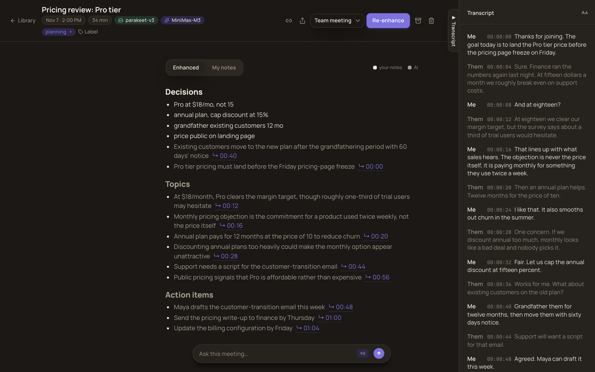
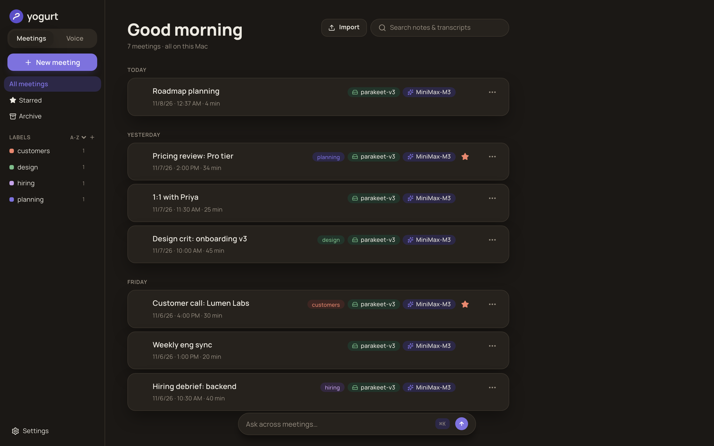
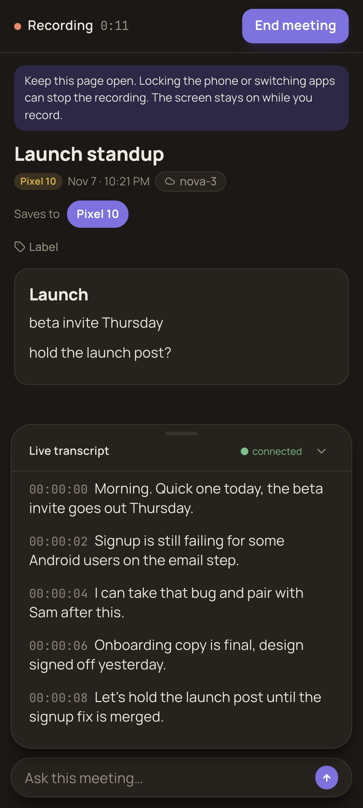
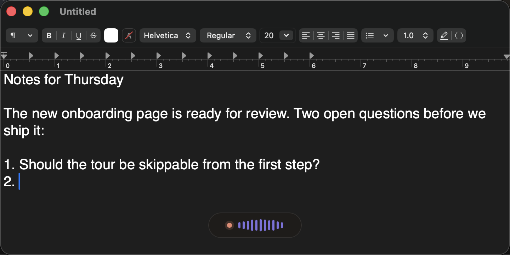
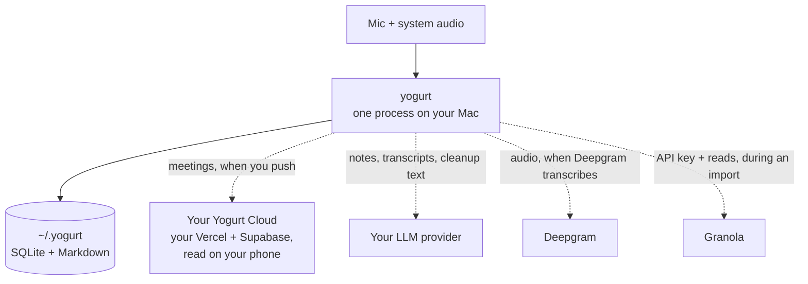

# yogurt

<p align="center">
  
</p>

> Local-first, open-source meeting copilot for macOS. Granola's UX, your machine.

[](LICENSE)

Yogurt records your mic and the Mac's system audio without a bot joining the call, transcribes live, and fuses your sparse bullets with what was actually said.
It is one Rust binary with a browser UI at `localhost:7878`, and it works with any OpenAI-compatible LLM you already pay for, or a local one.
An optional Yogurt Cloud on your own Vercel and Supabase accounts puts your meetings on your phone.

**Status:** stable, released through Homebrew and GitHub Releases.
The [releases page](https://github.com/jarvisrchen/yogurt-releases/releases) lists every version.

## Features

**Capture**

- Records your microphone and the Mac's system audio without a bot joining the call, and transcribes live with local Parakeet or whisper.cpp, or with Deepgram.
- A live recap in the transcript dock adds a few bullets about the discussion every 3 minutes, with Pause and Update now.
- Mute the mic with one key, and switch mic devices mid-meeting.
- Offers to record when a meeting window opens, and stops on its own when the call ends or goes quiet.

**Voice**

- [Yogurt Voice](#yogurt-voice) dictates into any app: hold a hotkey, talk, and let go.
  It transcribes on your Mac by default, and can clean up the text with a model that also runs on your Mac.

**Notes**

- After the meeting, your bullets stay as written and the LLM fuses in what was said, each line linked to its moment in the transcript.
- Picks a note format for the kind of meeting, or uses the one you choose, and re-enhances on demand.
- Chat with one meeting, or ask a question across all of them from the Library and see which meetings the answer came from.
- Every meeting is also a Markdown file on disk.

**Library**

- Search across notes and transcripts, star meetings, sort them under labels, and archive what you want out of the way but kept.

**Your data**

- Bring your own OpenAI-compatible LLM, or a local CLI agent: Claude Code, Cursor Agent, OpenCode, Codex, or GitHub Copilot.
- Import your Granola notes, with their summaries, transcripts, and folders as labels.
- [Read every Mac's meetings and record new ones on your phone](#read-and-record-on-your-phone) from Yogurt Cloud, a webapp on your own Vercel and Supabase accounts.

**Automation**

- [`yogurt ctl`](docs/CLI.md#yogurt-ctl) reads and controls a running instance from the shell.
- [Paste a meeting URL at a coding agent](#ask-an-agent-about-a-meeting) and it can answer questions about that meeting.

The full list, with where each feature lives in the app, is [docs/FEATURES.md](docs/FEATURES.md).

## What it looks like

The Library groups meetings by day, with search, stars, labels, and the Archive in the sidebar, and you can ask one question across all of them.

<p align="center">
  
</p>

During a meeting you type sparse bullets on the left, while the live recap and the transcript stream on the right.

<p align="center">
  
</p>

After the meeting (top of this page), the grey lines are what the LLM fused in, each with a timestamp link to the moment it came from.

## Install

Requires macOS 13 or later.

```bash
brew tap jarvisrchen/yogurt
brew trust jarvisrchen/yogurt   # Homebrew 7 loads short names only from a trusted tap
brew install yogurt
yogurt start
```

`brew install jarvisrchen/yogurt/yogurt` also works with no tap step, because a full name trusts that one formula as it installs.

<details>
<summary>From source</summary>

The free app's source is [jarvisrchen/yogurt-open](https://github.com/jarvisrchen/yogurt-open).
It needs Rust (the toolchain in `rust-toolchain.toml`), Node 22 with pnpm, and CMake.

```bash
git clone https://github.com/jarvisrchen/yogurt-open.git
cd yogurt-open
pnpm --dir web install && pnpm --dir web build
export YOGURT_BUILD_DATE="$(git log -1 --format=%cs)"   # stamps the build date into --version
cargo build --release       # or: cargo install --path crates/yogurt-cli
./target/release/yogurt start
```

</details>

<details>
<summary>Direct download (GitHub Releases)</summary>

```bash
curl -L https://github.com/jarvisrchen/yogurt-releases/releases/latest/download/yogurt-aarch64-apple-darwin.tar.gz | tar xz
# Intel Macs: yogurt-x86_64-apple-darwin.tar.gz
./yogurt start
```

- Keep `libexec/` next to the binary.
  It holds the llama.cpp libraries for Voice cleanup, and `yogurt` will not start without it.
- Browser-downloaded files carry a quarantine flag until notarization ships.
  If Gatekeeper refuses to run the binary, clear it once with `xattr -dr com.apple.quarantine ./yogurt ./libexec`.

</details>

## Updating

A Homebrew install updates itself: when a new version is out, a notice in the corner offers Update and restart, and Settings > About has Check for updates.
It waits for a recording to end, runs `brew upgrade`, and restarts yogurt in the same terminal on the same port.

To update by hand, stop the running server first (Ctrl-C where `yogurt start` runs), since a replaced binary takes effect only on restart.
Your data in `~/.yogurt/` is never touched, and migrations run on the next `yogurt start`.

| Installed with | Update | Watch out for |
| --- | --- | --- |
| Homebrew | `brew update && brew upgrade yogurt`, or `brew upgrade jarvisrchen/yogurt/yogurt` without a trusted tap | If [Releases](https://github.com/jarvisrchen/yogurt-releases/releases) shows a newer version than brew, the tap formula has not merged yet. Wait for it. |
| Source | `git pull`, the build steps above, then `./target/release/yogurt start` | `cargo build` alone leaves the old UI embedded in the new binary. |
| Direct download | Re-run the `curl` in the same folder | The quarantine flag comes back on every download, so clear it again. |

## First meeting

1. `yogurt start` opens `http://localhost:7878` in your default browser.
2. Grant Screen Recording and Microphone access when macOS prompts for them.
3. Start recording in a meeting.
4. Type sparse notes while you talk.
   A few words per point is enough.
5. Stop the meeting, and your notes get enhanced in place.

Something not working?
`yogurt doctor` checks permissions, providers, and models, and `yogurt doctor --json` is safe to paste into a bug report.

## Read and record on your phone

Yogurt Cloud mirrors your meetings to a webapp on your own Vercel and Supabase accounts.
It is optional and off until you connect it.

- Connect each Mac in **Settings -> Cloud sync**, and push by hand or on an interval.
- Read every Mac's meetings on the phone, and look back at the library as of any earlier push.
- Record a meeting on the phone with notes and a live transcript, and End enhances it with the same prompt the Mac uses.

<p align="center">
  
  
  
</p>

### Android app

Yogurt for Android wraps the Cloud webapp, records in the background, and can transcribe on the phone with no audio leaving it.

1. On the phone, open [https://github.com/jarvisrchen/yogurt-releases/releases/latest/download/yogurt-android.apk](https://github.com/jarvisrchen/yogurt-releases/releases/latest/download/yogurt-android.apk), or scan the code below.
2. If the download sits at 100% saying "Downloading...", open Chrome's menu -> Downloads and tap **Download anyway**.
3. Allow Chrome to install unknown apps once, then tap Install.

The app updates itself after that.

<p align="center">
  
</p>

## Yogurt Voice

Dictation into any app on your Mac: hold the hotkey (Fn by default), talk, and let go.
Yogurt pastes the text where your cursor is and puts your clipboard back.

<p align="center">
  
</p>

- Turn it on in **Settings -> Voice** and grant Accessibility once to the terminal that runs `yogurt`.
- A short tap starts hands-free dictation, and Esc cancels.
- It transcribes on your Mac with Parakeet by default, or with Deepgram if you pick it.
- Optional cleanup removes ums and self-corrections, with a model built into yogurt or an HTTP provider from **Settings -> Model**.
- The Voice page shows your dictation history, pace, and time saved.
- Audio is never saved, and the text stays local unless you pick a cloud model.

Setup, the model choices with their timings, cleanup, and the Voice page are in [docs/VOICE.md](docs/VOICE.md).

## Transcription models

Meetings transcribe with **Deepgram** (the default, needs an API key, sends audio to their API) or **locally** with no key and no network.
Switch under **Settings -> Transcription**.
A local model downloads from there to `~/.yogurt/models/`, and yogurt checks the SHA-256 of every file before use.

| Model | Size | Intel Macs | Notes |
| --- | --- | --- | --- |
| `parakeet-v3` | 670 MB | fine | **Recommended, and the default for Voice and new installs.** Multilingual. About twice as fast as `small.en`, and stays fast while a meeting uses the GPU. |
| `small.en` | 487 MB | fine | English only. Fast, and caught more personal names than Parakeet in testing. |
| `tiny.en` | 75 MB | fine | English only. Smallest and roughest, good for checking that local works. |
| `large-v3-turbo` | 1.6 GB | slow | Multilingual. Most accurate and slowest. It leans on arm64 Metal kernels, so it may not keep up with live speech on Intel. |

- `yogurt doctor` lists the models present, and `yogurt doctor --redownload-model small.en` re-fetches one.
- A model's files dropped into `~/.yogurt/models/` by any means are picked up, because yogurt identifies models by hash.
- `medium.en` and `large-v3` are retired: a setting that named one moved to `large-v3-turbo`, and a downloaded copy stays listed, tagged `retired`, until you delete it.

Parakeet TDT 0.6B v3 by NVIDIA, CC BY 4.0, converted to ONNX and quantized to int8 by the sherpa-onnx project.

<details>
<summary>Installing models with Homebrew, when huggingface.co is blocked</summary>

The models are mirrored on this repo's releases, so Homebrew fetches them from `github.com`.
The bytes are identical to Hugging Face's and checked against the same pinned SHA-256.

```bash
brew install jarvisrchen/yogurt/yogurt-model-parakeet-v3      # 670 MB, recommended
brew install jarvisrchen/yogurt/yogurt-model-small-en         # 487 MB
brew install jarvisrchen/yogurt/yogurt-model-tiny-en          # 75 MB
brew install jarvisrchen/yogurt/yogurt-model-large-v3-turbo   # 1.6 GB
```

- yogurt reads `$(brew --prefix)/share/yogurt/models` as well as `~/.yogurt/models`, and `yogurt doctor` shows which copy is in use.
- A brew model shows up in the picker tagged `brew`, with no delete button.
  Remove it with `brew uninstall` so Homebrew stays consistent.
- Voice's 2.5 GB cleanup model is over GitHub's 2 GiB release-asset limit, so it downloads only from Hugging Face, through **Settings -> Voice** or `yogurt ctl models download qwen3-4b-instruct`.
- `yogurt-model-medium-en` is deprecated with its model, and `brew uninstall` still removes it.

</details>

## Command line

| Command | What it does |
| --- | --- |
| `yogurt start` | Runs the server on `127.0.0.1:7878` and opens the browser |
| `yogurt doctor` | Checks permissions, providers, and models, and suggests repairs |
| `yogurt ctl` | Reads and controls a running instance from the shell, built for scripts and agents |

Every flag and the full `yogurt ctl` command list are in [docs/CLI.md](docs/CLI.md), and `yogurt <command> --help` is the source of truth.

## Ask an agent about a meeting

Every meeting page has a URL like `http://localhost:7878/meeting/<id>/post`.
Paste one at a coding agent, and it can read that meeting's summary or transcript and answer questions about it.
It can start and stop recordings too.
Install the skill once:

```bash
npx skills add jarvisrchen/yogurt-releases --skill yogurt-control --global
```

Then ask:

> what did we decide in http://localhost:7878/meeting/01a0594d-.../post

The agent talks to `localhost:7878` with the session token at `~/.yogurt/session-token`.
Your meeting content still goes wherever that agent sends its prompts, so treat it like pasting the notes into any other tool.
[docs/AI-INTEGRATION.md](docs/AI-INTEGRATION.md) has the full API for scripts.

<details>
<summary>Other ways to install the skill</summary>

- `--global` puts one copy at `~/.agents/skills/yogurt-control` and links every agent you have to it.
  Drop it to install into the current project, add `--agent claude-code` to pick one agent, and run `npx skills update` for a newer version.
- Without Node, fetch the one file by hand, into `~/.claude/skills/` for Claude Code or `~/.codex/skills/` for Codex:

  ```bash
  mkdir -p ~/.claude/skills/yogurt-control
  curl -fsSL https://raw.githubusercontent.com/jarvisrchen/yogurt-releases/main/.claude/skills/yogurt-control/SKILL.md \
    -o ~/.claude/skills/yogurt-control/SKILL.md
  ```

- A clone of this repo already has it at `.claude/skills/yogurt-control/`.

</details>

## How it works

One Rust process does everything: ScreenCaptureKit capture, live transcription, the LLM pass, an axum HTTP and WebSocket server, SQLite storage, Yogurt Voice, and the Cloud push.
There are no sidecars and no Electron.
The only child processes are a CLI agent you opt into as the LLM provider, and `open` for the browser.
[docs/ARCHITECTURE.md](docs/ARCHITECTURE.md) has the full design, sequence diagrams, and trust boundaries.



## Privacy

Nothing leaves your Mac except along the dotted lines above, and each one is a setting you control.

| Data | Leaves your Mac only if | And goes to |
| --- | --- | --- |
| Meeting audio | You keep Deepgram, the default, in **Settings -> Transcription** and do not switch to Local | Deepgram, audio only. It is deleted from disk after transcription. |
| Voice audio | You pick Deepgram in **Settings -> Voice** | Deepgram. Voice never writes audio to disk. |
| Dictated text | You turn on Voice cleanup with a cloud provider | That provider |
| Notes and transcripts | You configure an LLM provider | That provider |
| Meetings | You connect a Yogurt Cloud and press Sync now or turn on Auto-push | Your own Supabase, behind your Cloud login and PIN |
| Granola API key | You save or test it, preview, or import | Granola, with read requests only |
| API keys | Each is sent only to its own provider | Stored only in `~/.yogurt/keys.json` (mode 0600), never in the database, a response, or a log |

There is no telemetry, no phone-home, and no crash reporting, opt-in or otherwise.
[SECURITY.md](SECURITY.md) has the threat model and how to report a vulnerability.

## Contributing

Issues and pull requests go to [jarvisrchen/yogurt-open](https://github.com/jarvisrchen/yogurt-open).

## License

The source in [jarvisrchen/yogurt-open](https://github.com/jarvisrchen/yogurt-open) is MIT.
See [LICENSE](LICENSE).
The official app from Homebrew and GitHub Releases adds Yogurt Pro and ships under the [Yogurt Software License](https://yogurt-ai.dev/license), which keeps the MIT notice for the open parts.
