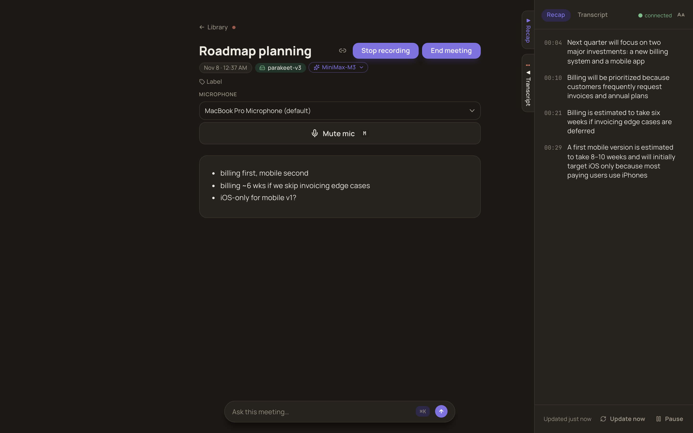
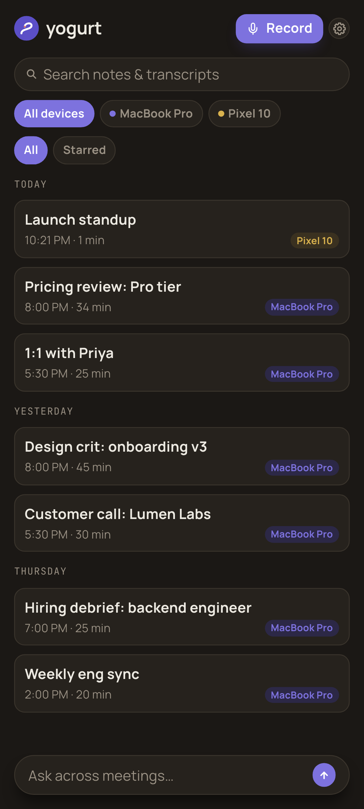
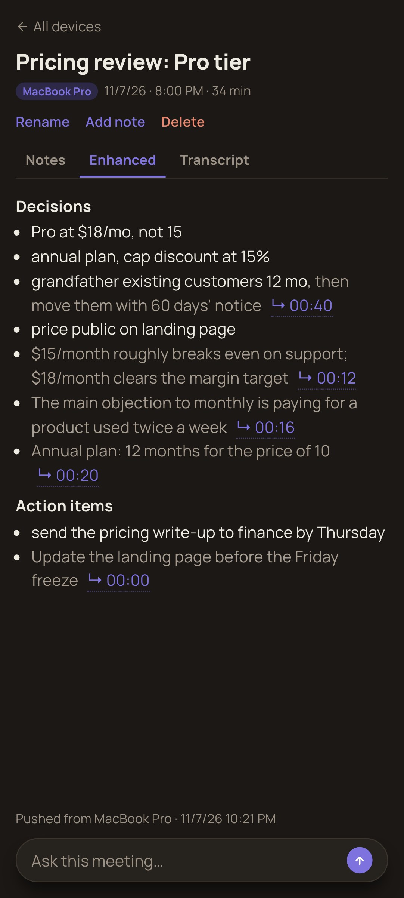
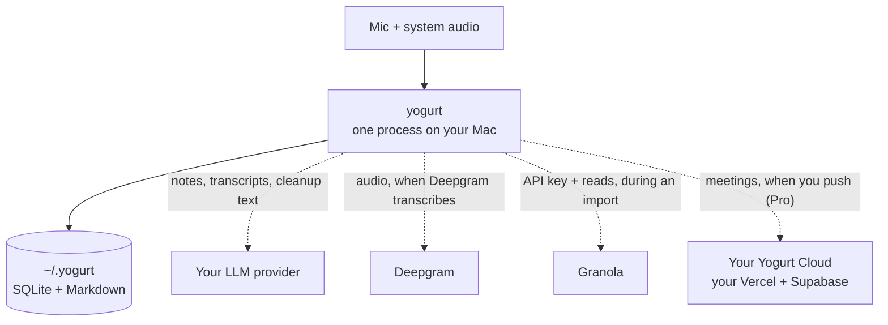

# Yogurt

> A meeting copilot for macOS that runs on your own Mac.

## Quick start

Yogurt needs macOS 13 or later.

```bash
brew install jarvisrchen/yogurt/yogurt
yogurt start
```

1. `yogurt start` opens `http://localhost:7878` in your browser.
   Grant Screen Recording and Microphone access when macOS asks.
2. Start recording in a meeting.
3. Type short notes while you talk.
   A few words per point is enough.
4. Stop the meeting, and Yogurt enhances your notes in place.

If something is not working, `yogurt doctor` checks permissions, providers, and models.
The output of `yogurt doctor --json` is safe to paste into a bug report.

<p align="center">
  
</p>

Yogurt records your microphone and the Mac's system audio, with no bot joining the call.
It transcribes the meeting live, and afterwards it fills in your short notes with what was said.
It is one program with a browser UI at `localhost:7878`, and it works with any OpenAI-compatible LLM you already pay for, or one that runs on your Mac.

Yogurt is free.
An optional paid upgrade, Yogurt Pro, adds more features and is sold at [yogurt-ai.dev](https://yogurt-ai.dev).

## Free and Pro

Free:

- Recording meetings, with the live transcript.
- Enhanced notes, in a format Yogurt picks for each meeting.
- The model of your choice, with your own API key or running on your Mac.
- Ask about one meeting, or across the meetings from the last 30 days.
- Up to 5 labels.
- Voice dictation, with the last 24 hours of history.
- Importing from Granola.

Yogurt Pro adds:

- Ask across every meeting.
- Unlimited labels.
- The archive.
- Meeting stats.
- The live recap, and switching the model during a meeting.
- Picking a note format, and comparing a re-enhance with the notes it replaced.
- Coding agents as your model: Claude Code, Cursor, OpenCode, Codex, and Copilot.
- Your full Voice history and Voice stats.
- The Voice dictionary, snippets, and style.
- Exporting and importing `.yogurt` meeting files.
- Cloud sync to a Yogurt Cloud you run on your own Vercel and Supabase accounts, which puts your meetings on your phone.

There are two ways to get Yogurt, and they differ in one thing.

| | Has the free features | Has the Pro features |
| --- | --- | --- |
| The official app, from Homebrew or GitHub Releases | Yes | Yes, once you add a license |
| A build of the source in [jarvisrchen/yogurt-open](https://github.com/jarvisrchen/yogurt-open) | Yes | No. The Pro code is not in that source, so a license changes nothing there. |

[docs/FEATURES.md](docs/FEATURES.md) lists every feature and where it lives in the app.

## What it looks like

These screenshots come from the official app with Pro on, so they also show the Archive, the live recap, and the note format picker.

The Library groups your meetings by day, with search, stars, and labels in the sidebar.

<p align="center">
  
</p>

During a meeting you type short notes on the left, and the transcript streams on the right, or the live recap with Pro.

<p align="center">
  
</p>

After the meeting (the first screenshot on this page), your notes stay as you wrote them.
The grey lines are what the LLM added, each with a link to the moment in the transcript it came from.

## Install

Homebrew, as in [Quick start](#quick-start), is the usual way, and it brings in-app updates.
Yogurt also builds from source or runs from a direct download.

<details>
<summary>Build the free app from source</summary>

You need Rust (the version in `rust-toolchain.toml`), Node 22 with pnpm, and CMake.

```bash
git clone https://github.com/jarvisrchen/yogurt-open.git
cd yogurt-open
pnpm --dir web install && pnpm --dir web build
export YOGURT_BUILD_DATE="$(git log -1 --format=%cs)"   # stamps the build date into --version
cargo build --release
./target/release/yogurt start
```

Build the web bundle first, because `cargo build` embeds it in the binary.

</details>

<details>
<summary>Direct download</summary>

```bash
curl -L https://github.com/jarvisrchen/yogurt-releases/releases/latest/download/yogurt-aarch64-apple-darwin.tar.gz | tar xz
# Intel Macs: yogurt-x86_64-apple-darwin.tar.gz
./yogurt start
```

Keep the `libexec/` folder next to the binary, because `yogurt` will not start without it.
If macOS refuses to run the download, clear its quarantine flag once with `xattr -dr com.apple.quarantine ./yogurt ./libexec`.

</details>

## Updating

A Homebrew install offers Update and restart in the app when a new version is out.
It waits for a recording to end, runs `brew upgrade`, and restarts on the same port.
To update by hand, stop `yogurt start` with Ctrl-C and run one of these.

| Installed with | Update |
| --- | --- |
| Homebrew | `brew update && brew upgrade jarvisrchen/yogurt/yogurt` |
| Source | `git pull`, then the build steps above again, web bundle included |
| Direct download | Run the `curl` again in the same folder |

An update never touches your data in `~/.yogurt/`.
The [releases page](https://github.com/jarvisrchen/yogurt-releases/releases) lists every version.

## Transcription models

Meetings transcribe with Deepgram or with a model on your Mac.
Deepgram is the default, needs an API key, and sends the audio to Deepgram's API.
A local model needs no key and no network once it is downloaded.
Switch under **Settings -> Transcription**, which also downloads the local models.

| Model | Size | Notes |
| --- | --- | --- |
| `parakeet-v3` | 670&nbsp;MB | Recommended, and the default local model. Multilingual and fast. |
| `small.en` | 487&nbsp;MB | English only. Fast, and caught more personal names than Parakeet in testing. |
| `tiny.en` | 75&nbsp;MB | English only. Smallest and roughest, good for checking that local works. |
| `large-v3-turbo` | 1.6&nbsp;GB | Multilingual. Most accurate and slowest, and may not keep up with live speech on an Intel Mac. |

Yogurt checks the SHA-256 of every model file before it uses it.
Parakeet TDT 0.6B v3 is by NVIDIA under CC BY 4.0, converted to ONNX and quantized to int8 by the sherpa-onnx project.

<details>
<summary>When huggingface.co is blocked</summary>

The transcription models are mirrored on the [yogurt-releases](https://github.com/jarvisrchen/yogurt-releases/releases/tag/models-v1) repo, and Yogurt tries that copy on `github.com` first.
Homebrew can install them from the same mirror.

```bash
brew install jarvisrchen/yogurt/yogurt-model-parakeet-v3
brew install jarvisrchen/yogurt/yogurt-model-small-en
brew install jarvisrchen/yogurt/yogurt-model-tiny-en
brew install jarvisrchen/yogurt/yogurt-model-large-v3-turbo
```

A model that Homebrew installed shows in the picker tagged `brew`, and `brew uninstall` removes it.
The 2.5 GB model for Voice cleanup is too large for the mirror, so it downloads only from Hugging Face.

</details>

## Yogurt Voice

Voice is dictation into any app on your Mac.
Hold the hotkey (Fn by default), talk, and let go.
Yogurt pastes the text where your cursor is and puts your clipboard back.

<p align="center">
  
</p>

Turn it on in **Settings -> Voice** and grant Accessibility once.
It transcribes on your Mac by default and never saves the audio.
An optional cleanup step removes ums and self-corrections, with a model that also runs on your Mac.
[docs/VOICE.md](docs/VOICE.md) covers setup, the model choices, and cleanup.

## Yogurt on your phone

This part needs Yogurt Pro.
Yogurt Cloud is a webapp that you deploy to your own Vercel and Supabase accounts.
Each Mac pushes its meetings there, and you read them on your phone or record a new meeting from it.

<p align="center">
  
  
  
</p>

Set it up with [one command](https://github.com/jarvisrchen/yogurt-releases/blob/main/cloud/SETUP.md), then connect each Mac in **Settings -> Cloud sync**.

### Android app

Yogurt for Android wraps the Cloud webapp, records in the background, and can transcribe on the phone so that no audio leaves it.

1. On the phone, open [the latest APK](https://github.com/jarvisrchen/yogurt-releases/releases/latest/download/yogurt-android.apk), or scan the code below.
2. If the download sits at 100% saying "Downloading...", open Chrome's menu -> Downloads and tap **Download anyway**.
3. Allow Chrome to install unknown apps once, then tap Install.

The app updates itself after that.

<p align="center">
  
</p>

## Command line and agents

`yogurt ctl` reads and controls a running Yogurt from the shell, for scripts and agents.
[docs/CLI.md](docs/CLI.md) has every flag and command.

A coding agent can read a meeting too.
Install the skill once:

```bash
npx skills add jarvisrchen/yogurt-releases --skill yogurt-control --global
```

Then paste a meeting's URL at the agent and ask:

> what did we decide in http://localhost:7878/meeting/01a0594d-.../post

The agent talks to `localhost:7878` on your Mac.
Your meeting content then goes wherever that agent sends its prompts, so treat it like pasting the notes into any other tool.
[docs/AI-INTEGRATION.md](docs/AI-INTEGRATION.md) has the API for scripts.

## How it works

One Rust process does everything: audio capture with ScreenCaptureKit, live transcription, the LLM calls, the web server, SQLite storage, and Voice.
There is no Electron.
Your meetings live in `~/.yogurt/` as a SQLite database, and each one is also a Markdown file.
[docs/ARCHITECTURE.md](docs/ARCHITECTURE.md) has the full design.



## Privacy

Your data leaves your Mac only along the dotted lines above, and each one is a setting you control.

| Data | Leaves your Mac only if | And goes to |
| --- | --- | --- |
| Meeting audio | Deepgram transcribes your meetings, which is the default until you pick a local model | Deepgram. The audio is deleted from disk after transcription. |
| Voice audio | You pick Deepgram in **Settings -> Voice** | Deepgram. Voice never writes audio to disk. |
| Dictated text | You turn on Voice cleanup with a cloud provider | That provider |
| Notes and transcripts | You configure an LLM provider | That provider |
| Meetings | You connect a Yogurt Cloud and push to it | Your own Supabase project |
| Voice dictionary, snippets, and daily totals | You press Upload to Cloud, or turn on Share daily totals | Your own Supabase project |
| Granola API key | You save or test it, preview, or import | Granola, with read requests only |
| API keys | Each is sent only to its own provider | Stored only in `~/.yogurt/keys.json`, readable by you alone |
| A purchased Yogurt Pro license | You add it, which activates this Mac once, or press Try again, rename this Mac, ask for the list of your Macs by email, or remove the license | yogurt-ai.dev: the license, a hash of this Mac's hardware ID salted with the license's email, and the name you give the Mac, its model by default. Asking for the list sends only the license. |

Yogurt has no telemetry, no analytics, and no crash reporting.
Besides the rows above, it makes these requests on its own behalf, and none of them carries your data:

- A Homebrew install checks for a new version once a day, and when you press Check for updates, by reading the Homebrew formula from `raw.githubusercontent.com`.
  You can turn the daily check off in **Settings -> About**, and a build from source or a direct download never makes it.
  Pressing Update reads the formula again and asks GitHub for the size of the download.
- A model downloads from `github.com` or `huggingface.co` when you ask for it.
- The Android app asks GitHub for a new version when it opens.

[SECURITY.md](SECURITY.md) has the threat model and how to report a vulnerability.
A Yogurt Cloud and the Android app send data of their own, such as a phone recording's audio to Deepgram.
The [privacy policy](https://yogurt-ai.dev/privacy) lists all of it.

## Contributing

Issues and pull requests go to [jarvisrchen/yogurt-open](https://github.com/jarvisrchen/yogurt-open).

Yogurt is developed in a private repository that also holds Yogurt Pro, and yogurt-open receives one commit per release.
So a pull request is never merged on GitHub.
When one is accepted, it is applied to the private repository and labelled `ported`.
It ships in the next release, and that release's commit credits you with a `Co-authored-by` line.
The pull request closes then, with a link to the release.

Before you open one, run the checks a free build must pass:

```bash
pnpm --dir web install && pnpm --dir web build
YOGURT_MEMORY_KEYSTORE=1 cargo test --workspace --features yogurt-stt/local-stt
cargo clippy --workspace --features yogurt-stt/local-stt --all-targets -- -D warnings
pnpm --dir web test
```

## License

The source in [jarvisrchen/yogurt-open](https://github.com/jarvisrchen/yogurt-open) is under the MIT License.
See [LICENSE](LICENSE).
The official app from Homebrew and GitHub Releases also contains Yogurt Pro, and ships under the [Yogurt Software License](https://yogurt-ai.dev/license).
