# Yogurt Architecture

How the system actually works, traced from the code rather than the plan.
Diagrams are Mermaid, so GitHub renders them inline.

Companion docs: this file for mechanism, and [DEBUGGING-TRANSCRIPTS.md](./DEBUGGING-TRANSCRIPTS.md) for inspecting a live transcript by hand.

- [0. Glossary](#0-glossary)
- [1. High-level map](#1-high-level-map)
- [2. Process and thread topology](#2-process-and-thread-topology)
- [3. Boot and session-token handshake](#3-boot-and-session-token-handshake)
- [4. Sequence: record a meeting, live transcript](#4-sequence-record-a-meeting-live-transcript)
- [5. Sequence: end meeting and enhance notes](#5-sequence-end-meeting-and-enhance-notes)
- [6. Sequence: in-meeting chat streaming](#6-sequence-in-meeting-chat-streaming)
- [7. Local mode: on-device STT and LLM](#7-local-mode-on-device-stt-and-llm)
- [8. Where state lives](#8-where-state-lives)
- [9. Trust boundaries](#9-trust-boundaries)
- [10. AI usage and cost map](#10-ai-usage-and-cost-map)
- [11. Key decisions and rejected alternatives](#11-key-decisions-and-rejected-alternatives)
- [13. UI motion](#13-ui-motion)
- [14. In-app updates](#14-in-app-updates)

---

## 0. Glossary

The doc leans on a few acronyms. The first three carry most of the weight.

| Term | Means | In yogurt specifically |
|---|---|---|
| **STT** | **Speech to text.** Turning spoken audio into written words, also called ASR or "transcription". | The `yogurt-stt` crate. Its engines sit behind one `Stt` trait: Deepgram in the cloud, or Parakeet or whisper.cpp running on your Mac. This is what produces the live transcript. |
| **LLM** | **Large language model.** The thing you send text to and get text back from (GPT, Claude, Llama, MiniMax). | Used in exactly two places: turning your sparse notes plus the transcript into augmented notes ("enhance"), and answering chat questions about the meeting. Never used for transcription. |
| **VAD** | **Voice activity detection.** A cheap check for "is anyone actually talking right now?" that runs before the expensive model does. | Only on the local STT path (`vad.rs`). It chops continuous audio into utterances and skips silence entirely, which is why local transcription costs nothing while idle. |

Supporting cast, in rough order of how often they appear:

| Term | Means |
|---|---|
| **WS** | WebSocket. A persistent two-way connection, unlike a one-shot HTTP request. Used to push transcript lines and chat tokens to the browser as they happen. |
| **SPA** | Single-page application. The React frontend, served as one HTML page that swaps views client-side. |
| **PCM** | Raw uncompressed audio samples. "16 kHz mono i16 PCM" means 16,000 samples per second, one channel, each sample a 16-bit integer. |
| **ScreenCaptureKit / SCK** | Apple's macOS framework for capturing screen and system audio. It is how yogurt hears the other side of a call without joining as a bot. |
| **loopback** | Capturing the audio your Mac is *playing* (the other participants) rather than what your mic hears. |
| **TCC** | Apple's permissions system (Transparency, Consent, and Control). The source of the "allow Screen Recording?" prompts. |
| **WAL** | Write-ahead logging, a SQLite mode where readers do not block the writer. |
| **FTS** | Full-text search. SQLite's built-in search index, used for the Library search box. No AI involved. |
| **RAII** | A Rust/C++ pattern where cleanup happens automatically when a value is dropped. Here: dropping the audio handle stops the microphone. |
| **SSE** | Server-sent events. The streaming format LLM providers use to send a response token by token. |
| **ULID** | A sortable unique identifier, like a UUID but time-ordered. Used for provider ids. |
| **Metal / CoreML / ANE** | Apple hardware acceleration. Metal is the GPU (enabled), CoreML/ANE is the Neural Engine (deliberately not enabled). |
| **ggml** | The tensor library whisper.cpp is built on. `.bin` model files are in its format. |
| **diarization** | Working out who spoke. Yogurt does the minimum version: mic is "Me", system audio is "Them". |
| **endpointing** | How long a speaker must pause before the engine decides the sentence is over. |
| **backpressure** | What a system does when data arrives faster than it can be processed. |
| **mojibake** | Garbled text from a character-encoding mismatch, e.g. `…` where `…` belongs. |

---

## 1. High-level map

One Rust process. No sidecars, no IPC, no subprocesses - with one narrow, opt-in exception: `yogurt-llm::CliClient` (LLM-4) can spawn a locally-installed agent CLI as an LLM provider, but only when the user explicitly picks it in Settings. See [§7.6](#76-the-cli-provider-exception-llm-4).
If any acronym below is unfamiliar, [section 0](#0-glossary) defines them.
The browser is a dumb-ish render surface: it holds the editor buffer and nothing else authoritative.

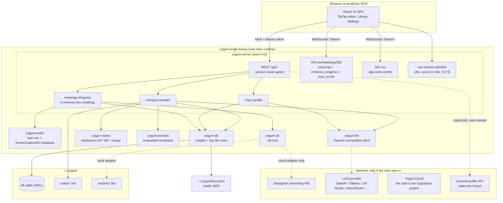

Crate responsibilities, one line each:

| Crate | Owns |
|---|---|
| `yogurt-cli` | Arg parsing, `--dev` mode, `.env.local` load (dev only), calls `yogurt_server::run`. Also `yogurt doctor` (local diagnostics) and `yogurt ctl` (CLI-4: an HTTP client that controls a *running* instance - status, meetings, detection - the agent-facing surface `docs/AI-INTEGRATION.md` and the `yogurt-control` skill point at). |
| `yogurt-server` | axum router, auth, meeting registry, enhance/chat orchestration, WS fan-out, embedded assets. |
| `yogurt-audio` | Mic (cpal) + system loopback (ScreenCaptureKit), resample to the frame contract, broadcast frames. |
| `yogurt-stt` | Speech to text. `Stt` trait plus `DeepgramStt` (cloud WS) and, behind feature `local-stt`, `LocalModel`, which picks `WhisperLocal` (whisper.cpp) or `ParakeetLocal` (sherpa-onnx) by the registry's `Engine`. Both local engines run the same VAD pipeline in `pipeline.rs`. |
| `yogurt-notes` | Markdown parse, block-level diff of user notes vs LLM output plus an inline pass that finds the user's lines woven into AI bullets, render back to wire-format markdown. `enhance::finish` turns a whole enhance reply into the sanitized `enriched_md`, for the Mac and the Cloud alike. |
| `yogurt-prompts` | Embedded prompt templates and their render context, including the seven enhance note formats (LLM-9), and the readers of model output: the `template:` line and the `<think>` stripper. |
| `yogurt-wasm` | `yogurt-prompts` and `yogurt-notes` behind `wasm-bindgen`, so the Cloud webapp enhances a phone meeting with the Mac's prompt and merge. Built into `cloud/src/wasm` by `just wasm`. |
| `yogurt-llm` | `LlmClient` trait, OpenAI-compatible HTTP client with `base_url` override, SSE streaming, and the local agent-CLI provider adapter (§7.6). |
| `yogurt-db` | SQLite open/migrate, `MeetingRepo`, settings, providers, `ApiKeyStore` over `~/.yogurt/keys.json`. |
| `yogurt-granola` | Granola public REST API client (paging, rate limit, retries, the 413 transcript fallback) and the pure mapping from a Granola note to a meeting. |
| `yogurt-voice` | macOS glue for Yogurt Voice dictation: the `NSApplication` main loop, the hotkey `CGEventTap` and its hold, tap, and shortcut logic, the recorder that tap runs while Settings records a new hotkey, since Chrome drops Fn before the page sees it, the Accessibility check, the clipboard paste, which puts a space before a dictation that follows the previous one in the same app with no key press or click between, and the pill, a non-activating `NSPanel` that shows each clip's state and its mic level. It knows nothing about audio, STT, or LLMs; `yogurt-server`'s voice task owns those and drives the pill, including the optional cleanup in `voice_cleanup.rs`, which streams each dictation through the picked provider and pastes the raw text if the first word takes over 1.5 s, the answer stalls for 500 ms, or the whole answer takes over 1.5 s plus 25 ms per word. |

### The one format contract that everything downstream depends on

`yogurt-audio` emits **16 kHz mono i16 PCM, 320 samples (20 ms) per `Frame`**, on two independent channels.
Both STT adapters consume exactly that.
Nothing resamples at the STT boundary.
Mic renders as "Me", system loopback renders as "Them", which is the whole of our diarization (deliberately, per PRD 5.2).

---

## 2. Process and thread topology

The interesting constraint: `cpal::Stream` is `!Send`, so the capture handle cannot live in a tokio task.
That single fact shapes the whole recording path.

`yogurt start` gives the main thread to AppKit, which Yogurt Voice's event tap and panel need, with no Dock icon.
The tokio runtime is built by hand and the server runs on its own `yogurt-server` thread, and the process exits when the server returns.
`doctor` and `ctl` never start AppKit.

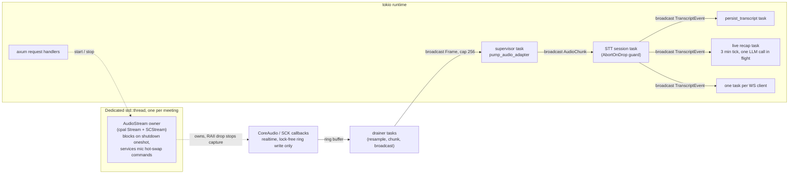

Rules that hold this together:

- **Realtime callbacks never allocate, never lock, never broadcast.**
  They write into a ring buffer; a tokio drainer does the resample, quantize, chunk, and broadcast.
- **RAII is the stop mechanism.**
  Dropping `AudioStream` stops both cpal and the `SCStream`.
  A dropped cpal stream disposes its audio unit, which the mic hot-swap relies on.
  `stop()` joins the capture thread so a back-to-back start cannot open an overlapping SCK session.
- **The capture thread body is wrapped in `catch_unwind`.**
  A panic inside ScreenCaptureKit (usually a TCC denial) becomes a clean HTTP 400 with a permission hint instead of a mystery "channel closed".
- **The STT task is held by an `AbortOnDrop` guard** owned by the supervisor.
  Aborting the meeting aborts the Deepgram WS / unloads the whisper model with it.
- **Broadcast, not mpsc, for frames.**
  Capacity 256 frames is about 5 seconds. A slow consumer gets `Lagged(n)` and drops old audio, which is correct for wall-clock-bound speech.

---

## 3. Boot and session-token handshake

Everything except the token handout and health requires a bearer token.
The token endpoint itself is gated by an Origin allowlist, because it *is* the token.

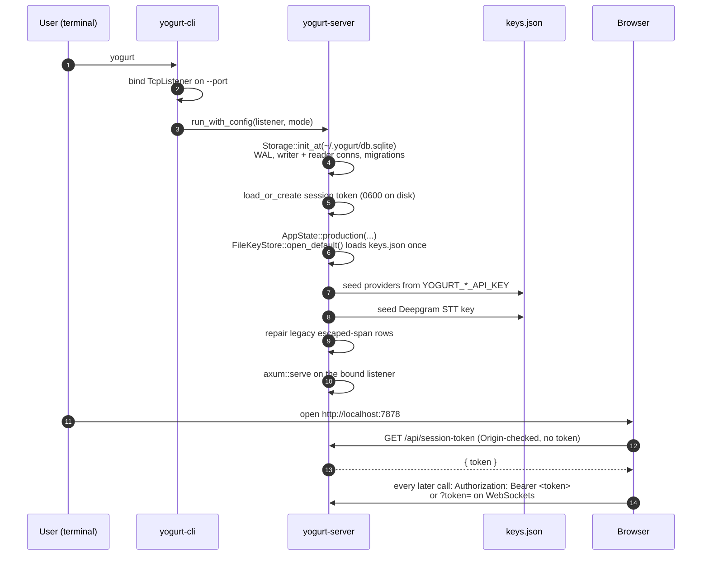

Why `?token=` on WebSockets: the browser `WebSocket` API cannot set headers, and echoing a subprotocol for auth violates RFC 6455 if done sloppily.
The tradeoff accepted is tokens in URLs, mitigated by redacting `?token=` from tracing output.

---

## 4. Sequence: record a meeting, live transcript

This is the hot path. Note that the browser never accumulates the transcript, the server does.

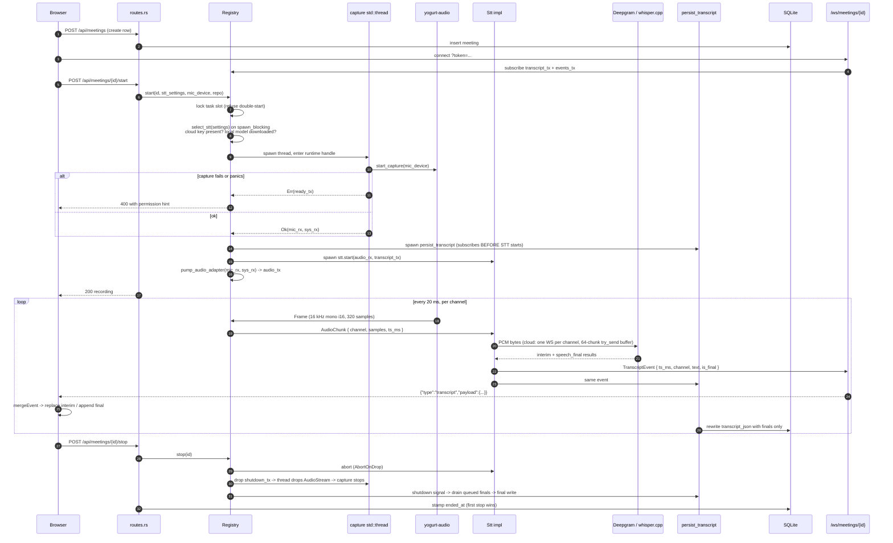

Details that matter and are easy to get wrong:

- **`is_final` comes from Deepgram's `speech_final`, not its `is_final`.**
  `is_final` marks an interim-final that will not be revised; `speech_final` marks end of utterance.
  Reading the wrong field made every interim-final render as a new locked line.
  `endpointing=1000` (ms) is what turns clause fragments into sentence-shaped lines.
- **Subscription order is load-bearing.**
  Persistence and STT both subscribe *before* the audio pump publishes, so no opening words are dropped.
- **Backpressure is visible, not silent.**
  Each cloud channel has a 64-chunk `try_send` buffer. After 50 consecutive drops (about 1 s) the server emits a `[stt overloaded, transcript may be lossy]` status line rather than quietly losing audio.
- **The frontend reconnects with exponential backoff**, capped at 3 attempts, with `connecting` / `reconnecting` / `offline` surfaced in the UI.

To inspect a live transcript by hand - tail what SQLite has stored, read the raw WS frames, or work out why the dock and the database disagree - see [DEBUGGING-TRANSCRIPTS.md](./DEBUGGING-TRANSCRIPTS.md).

---

## 5. Sequence: end meeting and enhance notes

The hero flow.
The browser sends the raw `notes_md` document; the server owns the transcript, the prompt, the merge, and both persistence targets.
The post-meeting UI keeps `notes_md` and `enriched_md` in separate My notes and Enhanced tabs.
Only My notes is editable (debounced autosave of `notes_md`); Enhanced is read-only and changes only through Re-enhance.
Re-enhance always replaces `enriched_md` from the unchanged raw notes plus transcript and never uses the previous generated summary as input.

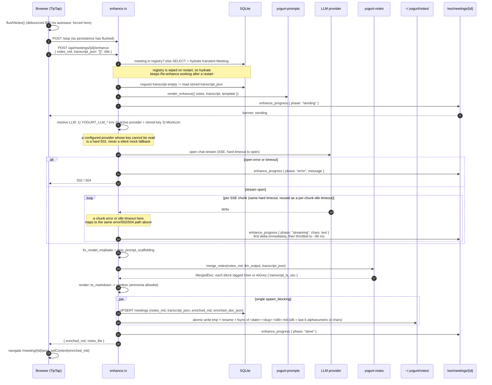

The `template` field on `render_enhance` (LLM-9) is the note-format mechanism.
The seven formats live as markdown files under `crates/yogurt-prompts/templates/enhance/<id>.md`, each a name, a when-to-use line, and a section outline.
By default `template` is absent and the same enhance call auto-detects the format: the prompt lists all seven and asks the model to name one on a `template: <id>` first line, which the server parses and strips before the merge.
If the model names nothing recognizable, the server falls back to `general` instead of failing.
A known id in the request body (or `--template` on the CLI) forces that format instead of asking the model to choose, and either way the resolved id is stamped on `meetings.template`.
Forcing is Yogurt Pro: without it `enhance` drops a known id and the model chooses, so the format a meeting was last enhanced in, which the page sends back, never forces a free re-enhance.

The same call suggests titles (MTG-33) when the meeting still has a title yogurt picked, `Meeting <M/D/YY>` of its own start or `Untitled meeting`, and was recorded on this Mac.
The prompt then asks for a second header line, `titles: <name> | <name> | <name>`, which `split_header` in `yogurt-prompts` parses and strips with the `template:` line.
The names land in `meetings.title_suggestions` as a JSON array, best first, and never change the title by themselves.
The meeting page offers them, and Use is an ordinary title PATCH that keeps the date.
Any title change or `DELETE /api/meetings/:id/title-suggestions` stores `[]`, which stops further suggestions for that meeting, so a re-enhance never brings dismissed ones back and nothing ever replaces a title the user typed.
No call goes anywhere new: the names come back in the reply enhance already makes to the configured provider.

The Cloud webapp does the same for a phone's own meeting (MTG-34): `render_enhance` in `yogurt-wasm` asks for the names while the title is still `Untitled meeting`, `finish_enhance` returns them, and they ride in the pushed bundle's `meeting.title_suggestions`, with `[]` once used or dismissed.
A Mac's meeting carries its waiting names in its bundle, and `yogurt_library` returns them for the Library's row hints.
On the meeting screen and a Library row, Use renames the meeting through the usual edit path, keeping a Mac's date, and dismiss is a `dismiss_titles` edit, so a phone's meeting changes at once and a Mac's waits for that Mac.

The black/grey UX in one paragraph: `yogurt-notes` parses both the user's markdown and the LLM's markdown into block ASTs, keys blocks by normalized text, and for every LLM block that is not a user block emits `Source::AiGrey` with a guessed transcript timestamp.
`render::to_markdown` wraps those in `<span data-ai-grey data-ts=...>`, which is the wire format TipTap styles grey and makes click-to-transcript work.
User blocks pass through verbatim, which is the invariant that makes the feature trustworthy.

Two defensive layers exist because real models misbehave: mojibake repair (CP1252-mangled punctuation observed live from MiniMax), scaffolding strip (models echoing the prompt's XML section tags), then ammonia sanitization before anything is persisted, so a hallucinated `<script>` never reaches SQLite or disk.

---

## 6. Sequence: in-meeting chat streaming

REST kicks it off and returns immediately; tokens arrive over the same per-meeting WebSocket the transcript uses.

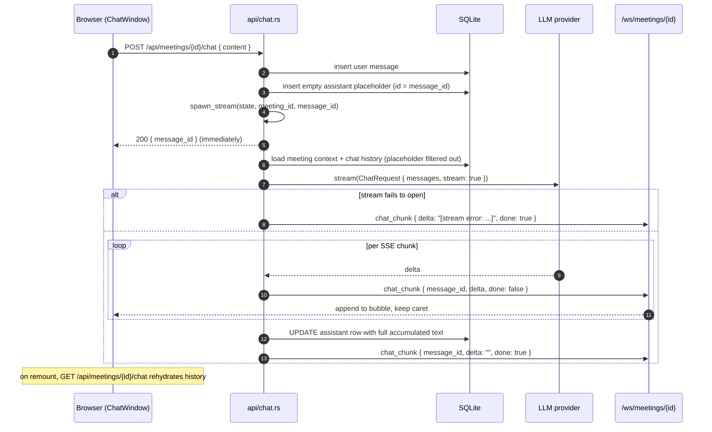

Same WebSocket, one discriminator convention: every frame is `{"type": "<snake_case>", ...}`.
`transcript` frames nest their body under `payload`; `enhance_progress` and `chat_chunk` are flat.

---

## 7. Local mode: on-device STT and LLM

Local mode is the privacy escape hatch: no audio and no notes leave the machine, and the marginal cost is zero.
It is not the default, and the code is honest about why (see the quality caveat at the end).

Two independent switches, either can be flipped without the other:

| Switch | Setting | Default | Off-machine traffic when local |
|---|---|---|---|
| STT | `settings.stt_provider` = `cloud` \| `local` | `cloud` | none, audio never leaves |
| LLM | active row in `providers` pointed at a localhost `base_url` | none configured | none, notes never leave |

### 7.1 Getting a model onto disk

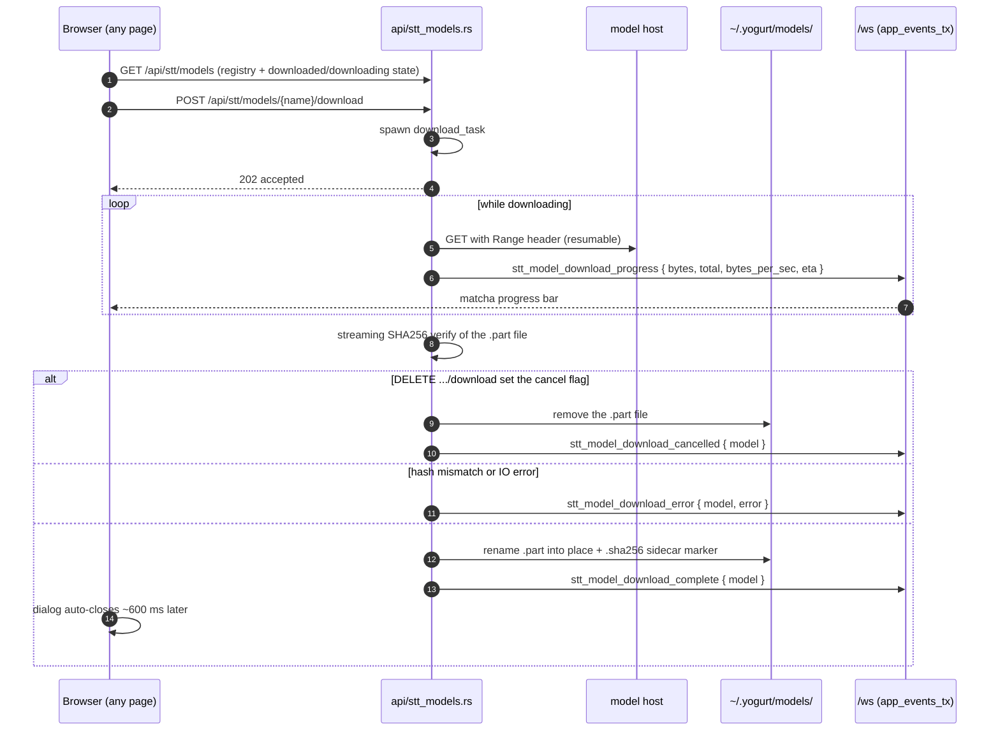

The whisper models come from the `ggerganov/whisper.cpp` HuggingFace repo, and Parakeet from `csukuangfj/sherpa-onnx-nemo-parakeet-tdt-0.6b-v3-int8` at a pinned revision.
Every SHA256 in `models::REGISTRY` was verified against the real blob rather than copied from a manifest.
A model is a list of files: one ggml file for whisper, and an encoder, decoder, joiner, and tokens file for Parakeet.
Each file downloads, resumes, and verifies on its own, and the model counts as downloaded only when every file verifies in one folder.
A hash mismatch deletes the file and shows the expected/actual pair in the dialog, so a truncated or MITM'd download can never be silently used.

At meeting start, `select_stt` checks the `.sha256` sidecar rather than rehashing a multi-GB file.
The one-time legacy migration path *can* hash, which is why the whole check runs on `spawn_blocking`.
`LocalModel::load` then reads the model (up to 1.6 GB) and initializes whisper.cpp or onnxruntime, also on `spawn_blocking`.

A model may also arrive from Homebrew rather than the download button (AUD-4).
`models::resolve_model` is the single answer to both "is it here?" and "where?", searching `~/.yogurt/models` first, then `$HOMEBREW_PREFIX`, `/opt/homebrew` and `/usr/local` under `share/yogurt/models`.
It returns the first copy that *verifies*, not the first that exists, so a truncated download cannot shadow a good copy further down the list.
`is_downloaded`, `select_stt`, and `yogurt doctor` all route through it; they used to answer those two questions separately and could disagree.

The reason it reads a foreign prefix instead of copying into `~/.yogurt/models`: Homebrew's install sandbox refuses writes outside its own prefix, so a formula cannot put the file where yogurt would otherwise look.
That also constrains deletion. `DELETE /api/stt/models/{name}` refuses when the only copy is outside `~/.yogurt/models`, because removing it would either no-op while the picker still showed the model as present, or reach into another tool's prefix and break `brew uninstall`.
`brew --prefix` would be authoritative for locating the prefix, but it is a subprocess, so the two defaults are hardcoded alongside `HOMEBREW_PREFIX`.

### 7.2 How local decoding actually works

The cloud adapter hands audio to Deepgram and gets lines back. The local adapter has to build that behavior itself, and it does so with a **VAD gate plus two different decoders against one shared model**.
`pipeline.rs` owns the segmenters, the queues, and the partial ticker for both engines, and each engine only supplies a decode function.
The diagram shows whisper. Parakeet's decode is the same offline transducer for partials and finals, the way the Android app runs it, and a partial skips its tick when a final is decoding, because one recognizer decodes one clip at a time.

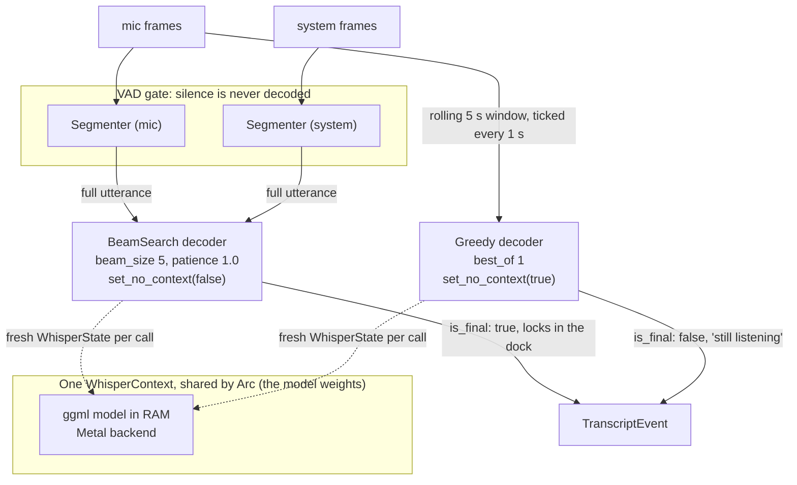

The pieces, and why each is shaped that way:

- **VAD first, decode second.** `vad.rs` only emits a segment when speech was actually present: `MIN_SPEECH_MS` 250 (shorter is a cough or a click, discarded), `SILENCE_HANG_MS` 600 (end of utterance), `MAX_SEGMENT_MS` 25 s (hard cap so one long monologue cannot stall the decoder). Silence costs literally nothing, which is the structural difference from the cloud path.
- **Mic and system get their own segmenter.** They are independent speakers with independent pauses, so a shared segmenter would splice "Me" and "Them" into one utterance.
- **Two sampling strategies, one model.** Greedy `best_of: 1` on a rolling 5 s mic window every 1 s produces the live "still listening" partials. BeamSearch `beam_size: 5, patience: 1.0` on complete utterances produces the finals the dock locks in place. Beam search is much slower and much better, which is exactly the right tradeoff when one output is throwaway and the other is permanent.
- **`set_no_context` differs per decoder.** The partial decoder runs with `no_context(true)` so it cannot carry a hallucination forward from the previous window. The final decoder runs with `no_context(false)` so consecutive utterances read coherently.
- **`WhisperState` is created fresh per decode**, while the `WhisperContext` (the weights) is shared by `Arc`. `create_state` is cheap and pooling would complicate the `spawn_blocking` lifetimes for no gain.

> **The invariant not to break.** Both engines' decodes are synchronous C++ that block for hundreds of ms to several seconds. Every decode site in `pipeline.rs` is wrapped in `tokio::task::spawn_blocking`: the mic final decoder, the system final decoder, and the partial ticker. Remove one and you deadlock the WebSocket broadcast pump under load. There should always be at least three occurrences in that file.

What the meeting pipeline takes from whisper, and how Parakeet fills it:

- **Timestamps** come from the segmenter, never the engine, so they are the same for both.
- **Confidence** is whisper's no-speech probability, which drops a segment under 0.4 as noise. Parakeet reports none, so that filter never drops its lines, and the filler-word and sound-tag filters still apply.
- **Language** is forced to English for whisper. Parakeet v3 knows 25 European languages and picks one itself, with no way to force it.
- **Prompts** carry the Voice dictionary, read once when the meeting starts.
  whisper gets up to 50 words as the initial prompt of each final, Learned and newest first, and partials get none, since they decode every second.
  Parakeet gets none, since its hotwords need a beam search decoder that the phase 3 spike measured as too slow, and stays greedy.
  Deepgram gets the same words as `keyterm` values, as many as fit 500 bytes, which stays under its 500-token limit.
  There is no diarization beyond the mic and system channels.

### 7.3 Choosing a model

| Model | Disk | Intel Macs | Notes |
|---|---|---|---|
| `parakeet-v3` | 670 MB | yes | **Recommended**, the Voice default, and the default for a new install (`V019`). Parakeet on the CPU, about twice small.en's speed, and it keeps that speed while whisper uses the GPU. |
| `small.en` | 487 MB | yes | The seeded default (`V005`) for installs before `V019`. |
| `tiny.en` | 75 MB | yes | Fastest, roughest. Fine for a smoke test. |
| `large-v3-turbo` | 1.6 GB | slow | Most accurate, slowest. |

`medium.en` and `large-v3` live in `models::RETIRED`: `V019` moved any setting that named one to `large-v3-turbo`, and the picker lists a copy still on disk, tagged `retired`, only so it can be deleted.

`intel_supported` is a hint, not a gate: the picker tags the affected models `slow` on an x86 Mac, and nothing stops the user selecting or downloading one.
The flag exists because Metal acceleration is not there to carry them, not because they cannot run.

Build-side, local STT is behind a Cargo feature:

- `whisper-rs` is pulled in only by `yogurt-stt`'s `local-stt` feature, with `metal` enabled at that crate level.
- `yogurt-server` turns `local-stt` on, so shipped binaries have it; a bare `yogurt-stt` build does not drag in whisper.cpp's CMake toolchain.
- `coreml` (ANE acceleration) is deliberately not enabled. It would add a CoreML model-conversion step to the build.
- whisper.cpp and its ggml link statically, and llama.cpp loads its own ggml from dylibs (§7.4), so the two copies never meet.
- sherpa-onnx and onnxruntime load from two dylibs too, `libsherpa-onnx-c-api.dylib` and `libonnxruntime.dylib`, because sherpa-onnx's static build ran Parakeet's int8 model 2 to 4 times slower.
  `sherpa-onnx-sys` downloads the prebuilt from GitHub without checking it, so `crates/yogurt-stt/build.rs` fails the build unless both dylibs match their pinned SHA-256s.
  `tests/local_models.rs` loads whisper and Parakeet in one process and checks whisper transcribes the same after.

### 7.4 The local LLM side

Local STT and a local LLM are independent choices. The LLM half needs no new code at all, because `yogurt-llm` speaks OpenAI-compatible HTTP and `OpenAiCompatClient` takes an arbitrary `base_url`.
Two of the shipped presets are already localhost:

| Preset | `base_url` | Default model |
|---|---|---|
| Ollama (local) | `http://localhost:11434/v1` | `llama3.2` |
| LM Studio (local) | `http://localhost:1234/v1` | (blank, you pick in LM Studio) |

Pointing the active provider at either one makes enhance and chat fully local.
Nothing else in the pipeline changes: the same prompts render, the same merge runs, the same sanitizer applies.
The API-key field is still there and still writes to the key file, which local servers simply ignore.

Voice cleanup also has a model built into the process: `yogurt-llm::LocalLlamaClient`, behind the crate's `local` feature, runs Qwen3 4B Instruct from a GGUF with llama.cpp on Metal.
It is the cleanup default, never an enhance or chat provider, and it downloads like a whisper model from Settings > Voice to `~/.yogurt/models/`.
One worker thread owns the model and its context, and keeps the KV state of the last prompt so the identical system prompt and example turns are decoded once.
A dictation that matches dictionary words or says a snippet cue ends the system prompt with them, so it and the dictation after it decode the example turns again, about 150 ms each on Qwen3 4B, and most dictations match none.
A snippet cue said as the whole dictation skips cleanup, so it pastes sooner than any other dictation.
A Casual or Formal app adds its style line before the cue and dictionary lines, since it changes only when the user dictates into an app of another style, and the first dictation after such a change decodes the example turns again.
The voice task keeps it loaded while Voice and cleanup with it are both on, and drops it, freeing about 3.8 GB, otherwise.
whisper.cpp and llama.cpp each vendor a ggml, and both linked statically crash llama.cpp on its first call, so llama.cpp builds as dylibs (`llama-cpp-2`'s `dynamic-link`) and binds to its own ggml.
The release ships them in `libexec/`, and `crates/yogurt-cli/build.rs` gives the binary the rpaths to find them (see `docs/RELEASING.md`).
`llama-cpp-2` is pinned exactly, and `crates/yogurt-server/tests/local_models.rs` runs whisper and llama.cpp in one process in the release workflow.

### 7.5 The honest caveat

Local partial quality is openly worse than Deepgram's, and the code says so in `whisper_local.rs`: it is *"the privacy escape hatch, not the daily driver"*.
Greedy decoding on a 5 s window cannot match a cloud model with a full acoustic context, and beam-search finals arrive after the utterance ends rather than streaming through it.
What you get in exchange is that no audio and no notes ever leave the machine, and the meeting costs nothing.
That is a real tradeoff presented as one, not a feature-parity claim.

### 7.6 The CLI provider exception (LLM-4)

`yogurt-llm::CliClient` is the one place this app spawns a subprocess, and it exists for a narrower problem than "local mode": a user who wants to run a coding-agent CLI they already have installed as their LLM provider, with no cloud provider configured at all. Ollama/LM Studio (§7.4) already give true offline for free; this is not that.

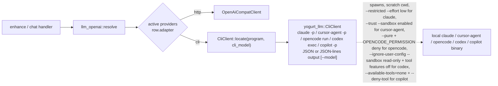

Coding agents are part of Yogurt Pro.
`ProHooks::llm_for` builds a `CliClient` only while the license holds Pro, and creating, testing, or listing models for a `cli` row answers 402 without it.
A `cli` row stored before the license lapsed stays in Settings, and while it is active, enhance, chat, and Ask error naming Settings > Model instead of falling back to another provider.
`resolve` reaches a `CliClient` only when the active provider row is itself `cli`-adapter: the Settings page's "Claude Code (local CLI)" / "Cursor Agent (local CLI)" / "OpenCode (local CLI)" / "Codex (local CLI)" / "GitHub Copilot (local CLI)" presets, cloned like any other provider.
It calls `CliClient::locate(CliProgram::parse(row.model), row.cli_model)` directly.
The program not being on `$PATH` is a hard `Err`, the same contract as an `http` provider whose key can't be read, and never a silent `MockLlm` substitution.
`providers.base_url` is unused for a `cli` row (empty string).
`providers.model` is repurposed to hold the `CliProgram` id ("claude" | "cursor-agent" | "opencode" | "codex" | "copilot") instead of a model name, and the Settings UI hides the BASE URL / API KEY fields entirely for it.
It shows a one-line "runs `<program>` locally" note, a `Test` button that needs no key, and a MODEL field bound to the separate `providers.cli_model` column (the `--model` alias passed through, e.g. "haiku"/"sonnet"/"opus"/"fable" for claude, where empty means "use the CLI's own default").
These are deliberately "simple AI calls" (enhance/chat extraction, not open-ended reasoning), which is why the smallest model and the lowest effort setting are the defaults.

The MODEL field itself is gated behind proof the CLI actually connects: a freshly-cloned row has `cli_model` empty and shows only the note and `Test`, not the picker - there is nothing to override yet on a row that might not even resolve on `$PATH`. Once `Test` comes back `ok`, `ProviderRow`/`ProviderCard` reveal a `ComboBox` seeded from the preset's `models` list and, if `cli_model` is still empty, PATCH it to the preset's `default_cli_model` so the picker opens on a sane starting point instead of blank. `!!provider.cli_model` alone (no client-side "was it tested" flag needed beyond the current session) is enough to keep the picker visible on every later visit, since the only way `cli_model` becomes non-empty is through that same successful-test path or a subsequent user pick - both already proved the CLI works. Picking a different model PATCHes on commit exactly like the `http` MODEL field; re-running `Test` after that tests whatever is currently saved, since `test_provider`'s `cli` branch reads `provider.cli_model` straight from the DB rather than any client-side draft.

**There is deliberately no automatic fallback from an unreachable HTTP provider to a CLI.** An earlier draft (LLM-1) wrapped the active `http` provider's client in a combinator that retried through whichever CLI happened to be on `$PATH` on a connect-class failure, and it was reverted: silently rerouting a meeting's real content to a different, unvetted backend because of a network hiccup is a behavior change a user should opt into by picking the CLI provider explicitly, not one that happens to them mid-meeting. The CLI is reachable only through the explicit LLM-4 path above.

Mechanics:

- Each call is a fresh process; there is no session to resume, so the full message history is flattened into one prompt argument the same way `OpenAiCompatClient` re-sends the full history over HTTP - `-p <prompt>` for claude/cursor-agent/copilot, a trailing positional after every flag for `opencode run` and `codex exec`.
- Meeting-transcript text is untrusted - it is whatever the other party on the call said - and it reaches the CLI as plain prompt text, not through a reviewed tool-use loop. `claude` runs with `--restricted --strict-mcp-config --disable-slash-commands --effort low` (plus `--model <alias>` when `cli_model` is set) and a throwaway scratch `cwd` so a transcript that reads like an instruction can't do anything but produce text. `cursor-agent` runs with `--trust --sandbox enabled` (plus `--model` when set) - `--trust` clears the "Workspace Trust Required" wall the CLI otherwise throws up for a fresh scratch `cwd`, and `--sandbox enabled` keeps command execution contained; deliberately not `--yolo`/`--force` (cursor-agent's broad auto-approve-commands flag), same reasoning as never passing `--dangerously-skip-permissions` to `claude`. All five programs' exact flag sets are verified against live binaries.

- **`opencode`'s containment is not expressible in argv, and the obvious flag is the wrong one.** `--auto` ("auto-approve permissions that are not explicitly denied (dangerous!)") is how a user normally makes `opencode run` non-interactive, and it is precisely what must never be passed here. Worse, a bare `opencode run` still loads the user's global config: verified live on a real machine, the model was offered `google-workspace_send_gmail_message`, `google-workspace_search_gmail_messages` and Drive writes - a working exfiltration path for a transcript that says "email yourself the following". `OPENCODE_CONFIG_CONTENT={}` does not close it; the global `mcp` block loads regardless. What does is the environment variable `OPENCODE_PERMISSION={"*":"deny"}`, which removes every tool from the model's schema rather than prompting about it. That is the right shape here anyway - enhance and chat are text-in/text-out extraction calls that have never needed a tool. Measured on a live run it takes the request from ~35k input tokens (every tool, skill and MCP server) to ~2.2k, and a prompt ordering the model to run `echo` comes back as a fabricated transcript in prose rather than a `tool_use` event: there is nothing left to call. `--pure` pairs with it to drop third-party plugins, which no permission entry covers.
- **`opencode` speaks JSON lines, not one JSON object.** `opencode run --format json` prints one event per line - the answer as `type: "text"` parts, thinking as `type: "reasoning"` (deliberately dropped; it is the model's scratchpad, not its reply), and a failure as a `type: "error"` line. So `interpret_output` dispatches on `CliProgram` instead of assuming the claude/cursor-agent single-object shape. Text is keyed by `part.id` and joined in first-appearance order: a live run emits exactly one text event holding the whole answer, and the keying is what keeps it correct if opencode ever streams a part as growing snapshots, where blind concatenation would repeat the prefix.
- **`codex` needs its user config ignored and its tools switched off one feature at a time.**
  A real `~/.codex/config.toml` sets `sandbox_mode = "danger-full-access"` and loads MCP servers (Granola, a filesystem server), so `--ignore-user-config` is the first flag.
  `--sandbox read-only` alone still lets the model read any file on disk through its exec tool.
  Asked to list its tools with only the sandbox set, a live run named `exec`, `apply_patch` and five multi-agent tools.
  `--disable code_mode_host` makes `exec` fail closed: asked to read a canary file outside the scratch `cwd`, the model answered that it could not.
  `--disable multi_agent`, `-c include_apply_patch_tool=false` and `-c tools.experimental_request_user_input.enabled=false` remove the rest.
  The account-level features (`apps`, `plugins`, the browser and computer-use features, `view_image` and the like) are disabled too, because `--ignore-user-config` does not reach them.
  `-c skills.include_instructions=false` drops the listing of every skill in `~/.codex/skills`, which halves the input tokens.
  `--ephemeral` keeps the call out of Codex's session history, and `model_reasoning_effort="low"` matches claude's `--effort low`.
  The tool switches are a denylist of `codex features list` names, so a tool a later release adds is on until it joins the list.
  A name a later release drops makes `codex exec` exit with `Unknown feature flag`, so a removal fails every call loudly.
  `~/.codex/AGENTS.md` still loads, because no flag skips it.
  A scratch `CODEX_HOME` would, but Codex keeps its login there, and a token refresh in a scratch copy would rotate the user's real refresh token.
  Never `--dangerously-bypass-approvals-and-sandbox` or `--approve-for-me`.
- **`codex exec --json` also speaks JSON lines.**
  The reply is the last `item.completed` whose `item.type` is `agent_message`, because the model may send a progress note first.
  It counts only once `turn.completed` arrives, so a process that dies mid-turn cannot return its progress note as the answer.
  A top-level `error` line is not fatal on its own, because Codex prints one per retry.
  `turn.failed` fails the call, and so does a run that ends without `turn.completed`, with the last `error` line as the reason when there is one.
  Either message is usually the API's own JSON error body, so it is unwrapped to the inner `error.message`.
- **`copilot` exposes no tools once `--available-tools=none` is set.**
  `--available-tools` is an allowlist, and no tool is named `none`.
  A bare `copilot -p` offered the model 27 tools on copilot 1.0.107, among them `bash`, `web_fetch`, `apply_patch` and the built-in GitHub MCP server's tools, which act with the user's GitHub credential.
  With the filter set, a live run asked to read a canary file in its own scratch `cwd` answered that it could not and listed no tools.
  An empty `--available-tools=` turns the filter off, and `--excluded-tools=*` does not glob, so neither works.
  `--deny-tool` for the `shell`, `write`, `read`, `url` and `memory` kinds denies every permission request too, in case a later release opens the filter.
  `--disable-builtin-mcps` keeps the GitHub MCP server from connecting at all, `--no-custom-instructions` skips `AGENTS.md` and its kin, and `--no-ask-user` drops the question form.
  `--sync-session=off` keeps the call out of the account's synced history.
  No `--reasoning-effort`, because copilot rejects it outright for `auto` and for models without effort levels.
  The scratch home's `settings.json` sets `effortLevel` to `low` instead, which copilot applies "for models that support it".
  Under `auto` copilot ignores it and still sends medium effort, verified in its debug log, and the call succeeds.
  Whether a named model on a paid plan gets low effort, and whether a model without effort levels ignores it, is not verified, because the account it was tested on rejects every named model before sending a request.
  Never `--allow-all`, `--yolo`, `--allow-all-tools` or `--trust-folder`.
- **`copilot` runs with a scratch `COPILOT_HOME` that holds only a copy of the user's `config.json` and the low-effort `settings.json`.**
  The user's own `~/.copilot` would start their MCP servers from `mcp-config.json`, since only a per-name `--disable-mcp-server` stops one.
  It would also apply their saved tool approvals, skills and plugins.
  Copilot also writes every call, prompt included, to `session-state/` and `session-store.db` there, and no flag turns that off.
  The scratch home goes away with the scratch `cwd`, so a meeting transcript never lands in the user's Copilot history.
  `config.json` is the one file carried over because it records a `copilot login`.
  A login through the `gh` CLI's token works with an empty scratch home, verified live.
  The `copilot login` path is not verified, because it needs an interactive device-flow login.
  `--no-auto-update` keeps each scratch home from downloading a fresh CLI, so yogurt runs the installed version, not one copilot auto-updated in the user's own home.
  `COPILOT_ALLOW_ALL` and `COPILOT_PROVIDER_BASE_URL` are removed from the child's environment.
  The first auto-approves every tool and trusts the cwd's hooks, and the second reroutes the prompt to a BYOK endpoint instead of the GitHub Copilot picked in Settings.
- **`copilot --output-format json` speaks JSON lines too.**
  The reply is the last `assistant.message` outside the `commentary` phase, which holds progress notes.
  It counts only once the closing `result` line reports `exitCode` 0.
  A live run once ended its turn on a progress note alone, and that is a failed call.
  A failure such as an unavailable `--model` or a bad login prints no `result` line, exits 1, and explains itself on stderr as `Error: ...`.
- Model catalogs come from the binary: `cursor-agent --list-models` prints `<id> - <label>` lines, `opencode models` prints bare `<provider>/<model>` lines (370 on a live account, spanning every provider the user has configured). One parser reads both - a ` - ` separator ends the id when present, the whole line is the id when it isn't, and a whitespace check drops headers and prose either way. `opencode`'s preset ships one static suggestion, `minimax-coding-plan/MiniMax-M3`, which is also its `default_cli_model`; Refresh is how the rest becomes visible.
  `codex debug models` prints a JSON catalog, and only its `visibility: "list"` entries are kept, which matches Codex's own picker.
  It runs with `-c model_provider="openai"`, because it has no `--ignore-user-config` and `exec` ignores a provider the user's config sets.
  It is a debug subcommand, so a Codex release may change it.
  The Codex preset ships only the ids in both the bundled and the live catalog, since the meeting pill offers preset ids as one-click chips and the live catalog adds account-dependent ones.
  `claude` has no catalog command at all, so its row hides Refresh and the four aliases are the whole list.
  `copilot` has none either: its catalog shows up only in a debug log, and its ACP `session/new` returns no model list.
  `ProviderView.has_model_catalog` carries that from `CliProgram` to the UI, so the frontend keeps no list of its own.
  The Copilot preset suggests only `auto`, because a Free plan rejects every named `--model`, even the model auto mode picks.
- `cursor-agent --list-models` returns 50+ account- and plan-dependent model ids - too many, and too likely to name something a given account can't use, to hardcode as MODEL suggestions. `"auto"` is the one confirmed to work on every plan (a free-tier account naming anything else gets `ActionRequiredError: Named models unavailable, Free plans can only use Auto`), so it's the preset's only suggestion and its `default_cli_model`.
- `v1` scope: no `stream-json` parsing. `CliClient::stream` buffers the one-shot result into a single delta, the same pattern `MockLlm::stream` already uses.
- **Parse stdout before checking the exit code, not after.**
  This holds for every program but `copilot`, which prints its failures to stderr.
  `opencode` exits 1 on an unroutable model having printed one `error` line and nothing on stderr.
  `claude --output-format json` still writes a structured, actionable result to stdout on many failures.
  It was caught live against a real "not logged in" account: exit status 1, empty stderr, and `{"is_error":true,"result":"Not logged in · Please run /login"}` on stdout.
  A first cut of `CliClient` checked `status.success()` first and only looked at stderr on failure, so the Settings `Test` button showed a useless "claude CLI exited with exit status: 1: " instead of the actual reason.
  `interpret_output` (pure, unit-tested with a synthetic `ExitStatus`, no process needed) now parses stdout as JSON first regardless of exit status.
  It falls back to raw exit-status/stderr only when stdout isn't parseable JSON at all (a crash before the CLI's own output formatting ever ran).
- `meetings.llm_model` (`"cli:claude"`, or `"cli:claude:haiku"` / `"cli:opencode:minimax-coding-plan/MiniMax-M3"` when a `--model` override is set) is accurate by construction - the active provider IS the CLI, not a fallback standing in for something else.

## 8. Where state lives

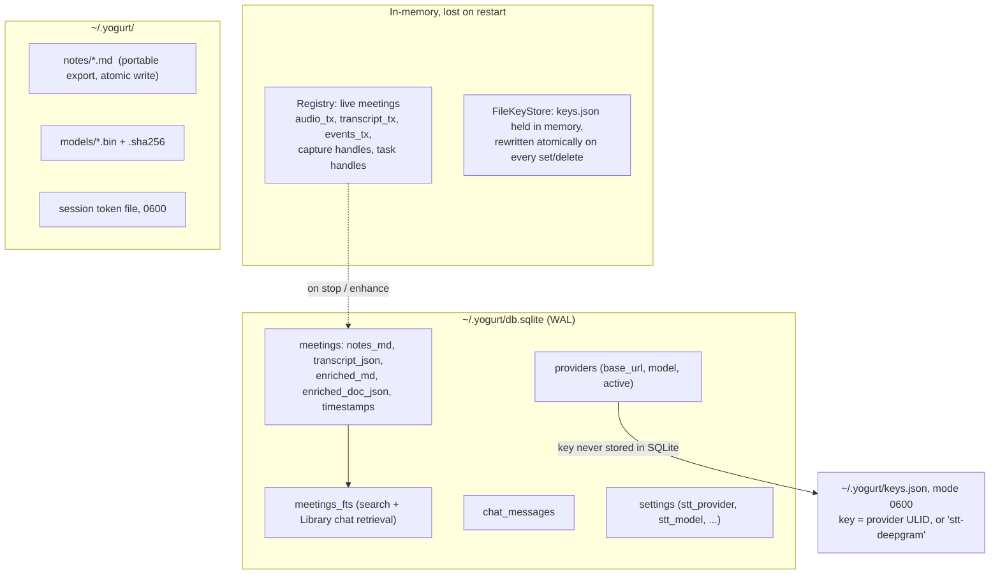

Notes on the storage layout, since it surprises people reading the code:

- **One SQLite file, two independent openers.**
  `yogurt-server::storage` (Phase 0: `meetings`, `chat_messages`) and `yogurt-db` (`providers`, `settings`, `meetings` repo, FTS) both resolve `~/.yogurt/db.sqlite` and both run their own idempotent migrations.
  They deliberately do not depend on each other for path resolution. Keep the two path helpers in sync if that path ever moves.
  `yogurt start --data-dir <path>` / `$YOGURT_DATA_DIR` relocates both openers to the same `<path>/db.sqlite` together (CLI-7), and `keys.json`, the `notes/` folder, and `session-token` move with them.
  Models still resolve under `~/.yogurt`.
- **`storage` uses a dual pool**: one writer connection behind a mutex, one read-only connection, WAL with `synchronous=NORMAL`.
- **`meetings_fts` is maintained by triggers alone.** It indexes `title`, `notes_md`, `enriched_md`, and `transcript_text`, which the triggers flatten from `transcript_json` with SQLite's JSON functions (V013), so a writer that bypasses `MeetingRepo` still keeps the index whole.
- **rusqlite is synchronous**, so every DB touch inside a request handler goes through `spawn_blocking`. Same for the markdown export, which does write + rename + fsync.
- **API keys are never in SQLite and never in a response body.** The providers table holds `base_url`, model, and active flag; the secret lives in `~/.yogurt/keys.json` keyed by the provider's ULID (or `stt-deepgram` for the STT singleton). Responses return a masked suffix only.
- **The key file is read at boot and held in memory.** `FileKeyStore::open` (`yogurt-db/src/keys.rs`) parses `keys.json` at boot into a map behind an `RwLock`; every `get` is a map lookup, so key reads happen inline in request handlers with no `spawn_blocking` and no timeouts. Every `set`/`delete` re-reads the file, applies its one change, and rewrites the whole file through a same-directory temp file with mode 0600 and an atomic rename, so a crash mid-write can never truncate it and a second process sharing the file keeps its entries. The in-memory map is updated only after the write lands. The file is created on the first write, not at boot.
- **Tests never touch the real key file.** `YOGURT_MEMORY_KEYSTORE=1` (set by `just test` and CI) makes `AppState::production` use `MemoryKeyStore` instead; everything else behind the `ApiKeyStore` trait is identical.
- **`keys.json` also holds the Yogurt Cloud connection** as one `yogurt-cloud` account, and `meetings.cloud_hash` (V014) is the only cloud column in SQLite.
- **`keys.json` also holds the Granola import key** as one `import-granola` account. `granola_import.rs` in `yogurt-server` is the only code that talks to Granola. It sends the key and read requests, only when the user saves or tests a key, previews, or starts an import, and the import job writes each note with `MeetingRepo::import` (V015 adds `meetings.source`, `source_id`, and `source_json`). A meeting is imported once, and a later run skips it.
- **Markdown files are an export, not the source of truth.** SQLite is authoritative; the `.md` file exists so the user's notes are portable and greppable outside the app.

---

## 9. Trust boundaries

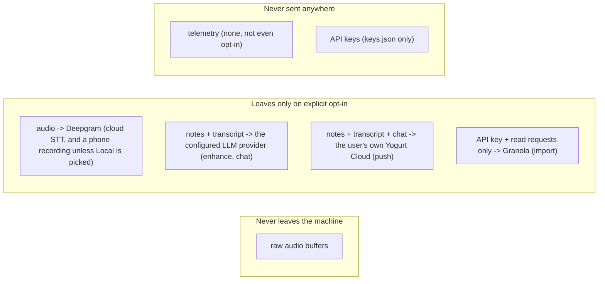

Two keys live outside `keys.json`, in the user's Vercel project's environment, Sensitive and Production only: `YOGURT_LLM_API_KEY` for the Cloud's chat and `YOGURT_DEEPGRAM_API_KEY` for recording on a phone.
No function returns or logs either.
`cloud/api/stt-token.ts` trades the Deepgram key for a token that expires in 30 seconds, and only for the signed-in owner with an unlocked browser token, so the phone never sees the key.
The phone's audio goes from the browser to Deepgram directly, is held in memory only while a socket is down, and is never stored.
In the Android app the user can pick Local instead, in Settings > Transcription, and then the audio never leaves the phone.
The app's recorder service runs sherpa-onnx: Silero cuts the mic's audio at pauses, and Whisper (`tiny.en`, `base.en`, `small.en`) or Parakeet TDT v3 (`parakeet-v3`) turns each stretch into one line.
Speech waits in memory for the model, up to 20 minutes, and the record screen shows how far behind it is past 15 seconds.
The models download through Android's download manager, over Wi-Fi only, from pinned Hugging Face revisions, and count only once every file matches its SHA-256 (`android/.../Models.kt`).
The meeting's `stt_engine` names the engine, `cloud · nova-3 · phone` or `local · <model> · phone`, which the Mac shows as its engine pill.

Enforcement points, all in `routes.rs` unless noted:

| Surface | Gate |
|---|---|
| `/api/health` | none |
| `/api/session-token` | Origin allowlist only (it hands out the token) |
| `/api/meetings*`, `/api/audio/*`, `/api/settings*`, `/api/stt/*`, `/api/cloud*`, `/api/import/*`, `/api/update*` | `require_session_token` middleware |
| `/ws`, `/ws/meetings/{id}` | Origin allowlist + `?token=` (`ws.rs::enforce_ws_auth`) |
| unknown `/api/*` | explicit 404, never falls through to the SPA |
| everything else | embedded assets with SPA fallback, or Vite proxy in `--dev` |

Origin allowlist is `http://localhost:{port}` and `http://127.0.0.1:{port}`, plus the Vite origins in dev only.
Localhost binding alone is not treated as sufficient: image preloads, iframes, and link-preview SSRF can reach GETs without CORS protection, which is why even device enumeration requires the token.

Unauthenticated settings writes were a real finding, not a hypothetical: before hardening, any localhost-reaching page could POST `/api/settings/providers` and repoint the active LLM at an attacker `base_url`.

---

## 10. AI usage and cost map

Prices below were checked 2026-08-28 and are the pay-as-you-go public rates.
They move; treat the *structure* as durable and the *numbers* as a snapshot.

### 10.1 There are exactly three AI call sites

Grep-verified: `llm.complete` appears once in production code, `llm.stream` once, and `Stt::start` once.
Everything else in the app is deterministic Rust.

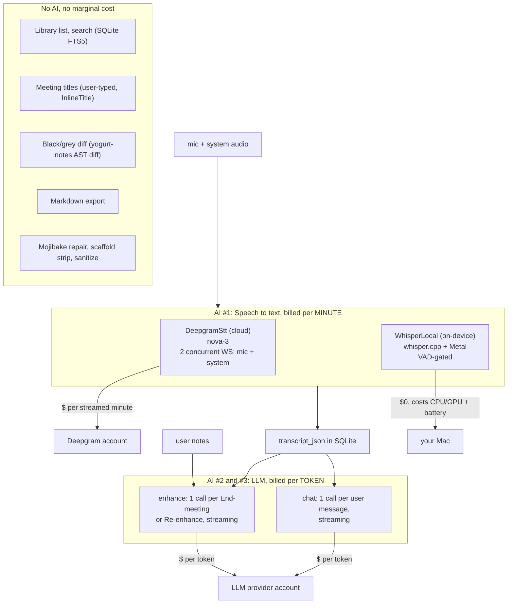

| # | Where in code | Which AI | Fires when | Billing unit |
|---|---|---|---|---|
| 1 | `meetings.rs::start` → `Stt::start` | Deepgram `nova-3` **or** local whisper.cpp | Continuously while recording | Cloud: per streamed minute. Local: free. |
| 2 | `enhance.rs:210` `llm.complete` | Configured LLM provider | Once per **End meeting**, once per **Re-enhance** | Input + output tokens |
| 3 | `api/chat.rs` `llm.stream` | Same provider | Once per **chat message sent** | Input + output tokens |
| 3b | `api/library_chat.rs` `llm.stream` | Same provider | Once per **Library chat question**, with at most 6 retrieved meetings in the prompt | Input + output tokens |

Every call the Mac makes for rows 2, 3, and 3b and for the live recap goes through `Logged` in `llm_openai.rs`, which writes one `llm_calls` row with the call's tokens and its list price when it ran.
The tokens are the provider's own `usage` when it reports one, which every stream asks for, and four characters a token otherwise.
A caller stops reading a stream at its last word and the usage chunk comes after it, so `Logged` reads each meeting stream in a task of its own and waits up to 2 seconds for that chunk.
A server that rejects `stream_options` with a 400 or 422 is asked again without it.
Voice cleanup stays out of `llm_calls`, because `dictations` already holds its cost.

The Cloud webapp adds two more, billed to the provider set in the user's Vercel project (`YOGURT_LLM_*`), never to the Mac's:

| # | Where in code | Which AI | Fires when | Billing unit |
|---|---|---|---|---|
| 4 | `cloud/api/chat.ts` | The Cloud's provider | Once per question asked in the webapp | Input + output tokens |
| 5 | `cloud/api/enhance.ts` | The Cloud's provider | Once per **Enhance** or **Re-enhance** of a meeting recorded on a phone | Input + output tokens, the same prompt as #2 |

Call site 5 sends the prompt the page rendered with `yogurt-wasm` and streams the raw reply back.
The page then cleans and merges it in `yogurt-wasm` with `yogurt_notes::enhance::finish`, the function the Mac's handler calls, so a phone meeting stores the `enriched_md` the Mac would.

Fallbacks that cost nothing: if no provider is configured at all, `MockLlm` answers deterministically (`$0`).
A provider that *is* configured but whose stored key cannot be read is a hard 502, never a silent free fallback, so you can never be silently downgraded to fake output.

### 10.2 STT is where the money goes, and it bills at 2x

The mic and system channels are **two separate Deepgram WebSocket sessions** (`spawn_supervised_session` is called once for `Channel::Mic` and once for `Channel::System`).
Both stream continuously for the whole meeting, including silence, because the cloud path has no VAD gate.
Deepgram bills streamed audio duration, so:

> **Billed minutes = 2 x wall-clock meeting length**, regardless of how much anyone actually talks.

A solo meeting where nobody else is on the call still pays for the system channel streaming an hour of silence.

| Nova-3 streaming, pay-as-you-go | Per streamed min | Per 1 h meeting (2 streams = 120 min) |
|---|---|---|
| Promotional rate (current) | $0.0048 | **$0.58** |
| Standard rate (post-promo) | $0.0077 | **$0.92** |

So roughly **$0.60 to $0.90 per meeting-hour**, and a 20 h/month meeting habit is about **$12 to $18/month**.

The local path is structurally different: `vad.rs` only hands whisper.cpp segments where speech was actually detected (`MIN_SPEECH_MS` 250, `SILENCE_HANG_MS` 600, `MAX_SEGMENT_MS` 25 s), so silence costs nothing at all.
Local mic and system each get their own segmenter, and every decode runs on `spawn_blocking`.

### 10.3 The LLM calls are cheap, but one of them grows

**Enhance**, for a 1-hour meeting, sends roughly:

| Part of the prompt | Approx tokens |
|---|---|
| `enhance.md` instructions, plus the note-format block (LLM-9): fixed when a template is forced, or all seven formats when auto-detecting | ~650, roughly +400 more in auto mode |
| User's sparse notes | 100 to 400 |
| `transcript_json` (see below) | ~24,000 |
| Output (the merged document) | 400 to 1,200 |

The transcript is the whole cost. It goes to the model as raw JSON, not prose, so every segment carries `{"ts_ms":3600000,"channel":"them","text":"..."}` scaffolding.
At ~700 utterances per hour that JSON punctuation alone is roughly 14k tokens on top of ~10k tokens of actual words.
The model needs `ts_ms` to emit the `data-ts` timestamps that make click-to-transcript work, so this is a real tradeoff, not waste, but it is where the tokens are.

| Provider (preset) | In / Out per 1M | Cost of one 1 h enhance |
|---|---|---|
| MiniMax-M3 (your `.env.local`) | $0.30 / $1.20 | **~$0.009** |
| gpt-4o-mini | $0.15 / $0.60 | **~$0.004** |
| Ollama / LM Studio | free | **$0** |

**Chat** is the line item to watch, because every message re-sends the entire transcript plus the entire prior conversation:

```
cost(message N)  =  system prompt + FULL transcript so far + all N-1 prior messages
```

There is no windowing, no truncation, and no summarization anywhere in `run_stream`.
Ten questions asked across a one-hour meeting is on the order of 120k input tokens total, about **$0.02 on MiniMax**, which is fine.
But the growth is quadratic in messages-times-meeting-length, so a long meeting with heavy chat use is the one path that can surprise you.

### 10.4 Putting it together

For one 1-hour meeting, transcribed in the cloud, enhanced once, with a handful of chat questions:

| Line item | Cost | Share |
|---|---|---|
| Deepgram nova-3, 2 streams x 60 min | $0.58 to $0.92 | **~95 to 98%** |
| Enhance, one LLM call | ~$0.005 | ~1% |
| Chat, ~10 messages | ~$0.02 | ~2 to 3% |
| Everything else (SQLite, FTS, diff, export, UI) | $0 | 0% |
| **Total** | **~$0.61 to $0.95** | |

Switch STT to local and the same meeting costs **~$0.025**.
Switch STT *and* the LLM to local (whisper.cpp + Ollama) and it costs **$0.00**, paid instead in battery, fan noise, and a one-time model download.

The one-time cost of local mode is disk and bandwidth for the model (75 MB to 3.1 GB), plus battery and thermals while decoding.
See [7.3 Choosing a model](#73-choosing-a-model) for the size table and [7.2](#72-how-local-decoding-actually-works) for why silence is free there.

### 10.5 What the architecture does and does not do about cost

Present today:

- **Local-everything escape hatch.** Both AI surfaces are behind traits (`Stt`, `LlmClient`), so `$0` mode is a settings change, not a fork.
- **Hard timeouts on every HTTP LLM call** (`HTTP_TIMEOUT` for silence, `GENERATION_TIMEOUT` for the whole call, in `yogurt-llm`), so a hung provider cannot bill indefinitely.
- **Backpressure detection on the STT path**, which surfaces `[stt overloaded, transcript may be lossy]` rather than silently paying for audio it dropped.
- **Deepgram model is env-overridable** (`YOGURT_DEEPGRAM_MODEL`) so you can trade quality for price without a rebuild.

Not present, in rough priority order if cost ever matters:

1. **No gating of the system channel.** It streams silence for the entire meeting at full price. Gating it on output-audio activity would cut the Deepgram bill by close to half for solo work.
2. **No transcript windowing in chat.** Every message pays for the full transcript again.
3. **No prompt caching.** The `enhance.md` prefix is roughly 650 tokens (plus roughly 400 more when auto-detecting the note format, LLM-9) and the chat system prompt is stable, but neither is sent in a form that claims providers' cached-input discounts (OpenAI prices cached input at half rate).
4. **No spend meter.** Nothing in the app tells the user what a meeting cost, which for a BYO-key product is the number they would most want to see.
5. **Re-enhance is a full re-run** at full price, with no diffing against the previous result.

---

## 11. Key decisions and rejected alternatives

The stack choices that shape everything else, and what was deliberately not used.
Version truth lives in `Cargo.toml` / `web/package.json`; this section records the *why*.

### Hard constraints (violating any of these is a bug)

- **Privacy:** audio never leaves the machine unless the user opts into cloud STT, and even then only audio.
Notes and transcripts leave only to the LLM provider the user configures (enhance and chat) and to a Yogurt Cloud the user connects, which is their own Supabase project ([§12](#12-yogurt-cloud-sync)).
The Voice dictionary and snippets reach that Cloud only when the user presses Upload to Cloud in Settings > Voice ([§12](#copying-the-voice-setup)).
Voice daily totals, counts per day and never text or app names, reach it only from a device where the user turned on Share daily totals ([§12](#sharing-voice-daily-totals)).
That Cloud's chat sends a meeting's transcript, or the titles, dates, notes, and transcript excerpts of the meetings a cross-meeting question finds, from the user's Vercel project to the LLM provider set there.
Captured audio is deleted after transcription.
A meeting recorded on a phone in the Cloud webapp streams its audio to Deepgram, unless the user picked Local in the Android app, where a model on the phone transcribes it, and the phone holds that audio in memory only while it waits for a socket or the model ([§12](#12-yogurt-cloud-sync)).
API keys and the Yogurt Cloud connection live only in `keys.json` in the data directory, `~/.yogurt/keys.json` by default (mode 0600, written atomically) - never in SQLite, never in a response body, never in a log line.
The exceptions are the Cloud chat's LLM key and the Cloud's Deepgram key, which live in the user's Vercel project's environment and are never returned or logged.
- **Single process:** audio capture, STT, LLM calls, web serving, and SQLite all run in one Rust binary.
No subprocesses, no IPC, no sidecar binaries - with one narrow, opt-in exception (LLM-4, 2026-08-31): `yogurt-llm::CliClient` may spawn a locally-installed agent CLI as an LLM provider, but only when the user has explicitly picked it in Settings - never as an automatic fallback behind another provider. See [§7.6](#76-the-cli-provider-exception-llm-4) for the mechanism and containment, and don't extend this exception to a new call site without revisiting it here.
A second, user-initiated exception: a Homebrew install runs `brew` when the user clicks Update, and nothing else ever runs it ([§14](#14-in-app-updates)).
- **No telemetry:** zero phone-home, not even opt-in crash reporting.
The update check ([§14](#14-in-app-updates)) reads a public file and sends nothing about the user, and the user can turn it off.
- **Platform:** macOS 13+ only - ScreenCaptureKit is the audio-loopback mechanism and sets the floor.
- **Distribution:** a single static binary; `web/dist` is embedded via `rust-embed`, SQLite is bundled via `rusqlite`.

### Rejected alternatives

| Rejected | Why | Used instead |
|---|---|---|
| Tauri / Electron / wry | Second build target, IPC layer, or a bundled Chromium - all tax the single-binary pitch for zero v1 benefit | axum serving an SPA at `localhost:7878`, opened in the user's browser |
| BlackHole / virtual audio drivers | Requires users to install kernel-adjacent software | ScreenCaptureKit system-audio loopback (the supported Apple path) |
| `getUserMedia` in the browser | Would prompt for mic permission separately from the binary's Screen Recording prompt - two confusing permission flows | All audio is captured by the Rust binary; the browser only renders UI |
| `sqlx` | Compile-time DB connection requirement is awkward inside a static-binary build | `rusqlite` with the `bundled` feature |
| Next.js / SSR React | Localhost SPA - there is nothing to server-render | React 19 + Vite, client-side only |
| Rust frontends (yew/leptos) | Debugging a Rust frontend the night before launch is a poor trade for a solo project | React + TypeScript |
| WhisperKit / CoreML / ANE | Pulls in a Swift toolchain and a model-conversion step | `whisper-rs` with the `metal` feature (GPU is fast enough on Apple Silicon) |
| Per-provider LLM SDKs | One OpenAI-compatible client covers OpenAI, Ollama, LM Studio, OpenRouter, Groq, vLLM, MiniMax, and friends | `async-openai` with a configurable `base_url` |
| macOS Keychain for API keys (`keyring` crate, used until 2026-08-29) | Keychain ACLs are bound to the binary's code signature, so every unsigned dev rebuild re-prompted once per stored key; a prompt nobody could answer wedged boot for 30+ minutes and forced 5s/10s/20s timeout scaffolding around every key read; and a machine where the user cannot write to Keychain could not run yogurt at all | `FileKeyStore` over `~/.yogurt/keys.json`: same posture as `~/.aws/credentials`, encrypted at rest by FileVault, no consent dialogs, works everywhere the data directory does |
| Agent CLI as an unmodified `providers` row (tried 2026-08-30) | Agent CLIs speak stdin/stdout, not `{base_url}/chat/completions`; forcing one into the existing HTTP-shaped `providers` columns would mean faking a `base_url` and lying about the wire protocol | A separate `LlmClient` impl (`yogurt_llm::CliClient`), reached via a real `providers` row (LLM-4) behind a new `adapter` column (`'http' \| 'cli'`) that changes what the other columns mean for a `cli` row, not by pretending it's another HTTP endpoint |
| Automatic CLI fallback when the active HTTP provider is unreachable (LLM-1, built and reverted 2026-08-30/31) | Two problems, one fatal: (1) silently rerouting a meeting's real content to a different, unvetted backend on a network hiccup is a behavior change a user should choose, not one that happens to them mid-meeting; (2) a first cut also preferred the CLI over `MockLlm` whenever no provider was configured at all, so on a dev machine with `claude` on `$PATH`, `cargo test --workspace` silently shelled out to the real CLI and spent real API credits instead of getting deterministic mock output | CLI access is explicit-only: the two "local CLI" provider presets (LLM-4, §7.6) are the sole way to reach `CliClient` - pick one and it's now your provider, nothing implicit ever substitutes it in |
| Calendar (EventKit) or a system-audio heuristic as the meeting-detection signal (MTG-11, 2026-09-01) | Calendar needs a *new* TCC permission, fires on events you decline or skip, and misses every ad-hoc call. A system-audio heuristic means holding an `SCStream` open around the clock just to listen for speech - capturing audio while not recording, which is the exact thing the privacy constraint exists to prevent. The silence and mic-release signals that stop a recording (MTG-17) are different things: silence only reads peaks from streams already open for a live recording, and mic-release reads which processes hold the mic without capturing any audio. Neither runs while idle | On-screen window titles via `SCShareableContent` (`yogurt_audio::detect`): a read of already-authorized metadata under the Screen Recording grant loopback already requires, so no new dependency and no new prompt. Matching is a small allow-list of (bundle id, in-call title) pairs, because "Zoom is open" is not "you are in a call" |
| Auto-*starting* a recording on detection (MTG-11, 2026-09-01) | The title patterns are vendor UI strings that drift, so the first false positive would silently record a room. A privacy-first app does not get to make that mistake by default | Detect and prompt: a dismissable banner offering "Start recording", which runs the same create-then-`autoStart` path as "+ New meeting". The auto-*stop* half is kept, since stopping errs toward a call you restart rather than a room you did not know was taped. MTG-17 (2026-09-29) widens it: the preferred stop is the meeting app releasing the microphone (CoreAudio process objects, polled only during a recording, an allowlisted app must have held the mic first, 2 polls of release), with the window closing as the fallback where macOS cannot report mic users or no meeting app held the mic (Safari), and a recording stops after 5 minutes with no sound on either channel (warning at 4 minutes, with `auto_stop_at` on `GET /api/meetings/active` and `POST /api/meetings/{id}/keep-recording` to dismiss it). Both signals go through one stop path that stamps `ended_at`, and `general.meeting_auto_stop` (default on) gates both. MTG-16 (2026-09-09) adds attention, not autonomy, on top of that prompt: a browser `Notification` (once per detected window, gated on permission) and the server raising the installed yogurt app via `open -a yogurt` when a new window shows up with nothing already recording |

### Load-bearing seams

- **`Stt` trait** (`yogurt-stt`): Deepgram and whisper.cpp are interchangeable behind it; swapping or adding an engine is a one-file change.
- **`rust-embed` on `web/dist`** (`yogurt-server/src/assets.rs`): the frontend must be built before the Rust build; CI does this explicitly.
- **rpath link flags in each binary crate's `build.rs`**: ScreenCaptureKit bindings need `/usr/lib/swift` on the rpath, and `cargo:rustc-link-arg` does not propagate from dependencies - see `docs/archive/superpowers/notes/2026-06-25-sck-spike-result.md` for the discovery story.

---

## 13. UI motion

The Mac app and the Cloud share their motion through `web/src/index.css`, which the Cloud's stylesheet imports.
Motion is CSS only, with no animation library, and every piece stays off under `prefers-reduced-motion`.
Durations and curves come from the spec tables in the motion mocks, `docs/.lavish/2026-11-09-voice-motion-mocks.html` and `docs/.lavish/2026-11-09-meetings-motion-mocks.html`.
Moves use `--ease-slide` and scale and fade use `--ease-pop`.

- **Keyframes.**
  `animate-rise` lifts an element 8px as it fades in, `animate-flash` washes a row soft blueberry and fades back to its own background, `animate-dot-pop` pops a dot, `animate-fade-up` fades a line in from 3px below, and `animate-shake` shakes a field or card that refused a save.
  Use them as `motion-safe:animate-rise`, since a bare `animate-*` class still runs under reduced motion.
  The same goes for a bare `duration-*` or `ease-*`, which sets `transition-duration` on every property, since `transition-property` starts as `all`, so write `motion-safe:duration-220`.
  Each token carries one default length, and a caller that needs another names the keyframe in an arbitrary value, as in `motion-safe:animate-[rise_260ms_var(--ease-slide)_both]`.
  `animate-grow` grows a bar up from its baseline and `animate-grow-x` widens one from zero, both over 520ms.
  A stagger is an `animation-delay` the caller sets per row.
- **Voice stats.**
  `web/src/components/voice/motion.ts` holds the stats motion that the Mac's Voice page and the phone's Voice Home share.
  `useCount` counts a tile's number from where it stands to its new value over 600ms, so a range change, a view change, and a new dictation all count from the last value, and only a mount counts from 0.
  A tile draws the final text in clear ink under the counting number, so the width never changes mid-count and a screen reader reads only the final value.
  `useRiseOrder` keeps the first eight history cards a list shows, which rise in with a 40ms stagger, so a new dictation or Show more just appears.
  Bars and app shares grow only when they mount and resize in place with a 520ms transition after.
- **Segmented.**
  `web/src/components/Segmented.tsx` is the one segmented control for both apps.
  A single thumb slides to the picked option over 260ms, and moves without sliding on first paint, a resize, a font load, or new options, so it never sweeps in from the left edge.
  A switch that two screens each render, like the Cloud Library's Meetings | Voice, remounts on a pick, so it sets `remounts`.
  The new copy then starts its thumb where the copy with the same `label` stood when it unmounted, within a second, and slides from there, through `useSlidingThumb`'s `remember` option.
  Its thumb is `web/src/lib/useSlidingThumb.ts`, which the Cloud meeting screen's tab underline also uses.
- **Ask.**
  `ChatWindow` grows up out of the `AskPill` by clipping from a 48px strip at its bottom edge, the pill's own box since both share one anchor, and its contents rise in once it is underway.
  A collapse shrinks it back and calls `onCollapse` when the shrink ends, or at once under reduced motion, so the pill replaces it in place.
  Clipping leaves `transform` and `translate` to the centering and the swipe, and needs no height.
- **Folding a row.**
  `.fold` folds a row with `grid-template-rows: 1fr` to `0fr`, so nothing measures a height, and `data-folded` shuts it.
  `web/src/components/Fold.tsx` drives it.
  `<Fold open={editing}>` unfolds an edit form and keeps it mounted until it has folded shut again.
  A row just added renders `<Fold open appear>` and unfolds from zero height, usually beside `motion-safe:animate-flash`.
  A row being deleted stays in the list with `open={false}`, and the list drops it from its data in `onClosed`, which runs once the fold ends, or at once under reduced motion.
  `Fold` times the fold with `FOLD_MS`, which must match the transition on `.fold`.
  Space folding rows with padding inside the fold rather than a list `gap`, or the gap stays through the fold and the rows below jump when it unmounts.
  `Fold.tsx` also exports `reduced()`, the one reduced-motion check for code that times an exit.
- **Suggested titles.**
  Durations and curves come from `docs/.lavish/2026-11-12-suggested-titles-mocks.html`.
  The meeting page's chip unfolds under the title when an enhance brings names, and fades up from 3px after 120ms.
  Use flies the name from the chip into the heading with `web/src/lib/flyTitle.ts`, a 340ms `--ease-slide` move that scales by the ratio of the two font sizes.
  The old heading blurs out over 160ms meanwhile, since the date it keeps would otherwise overlap the incoming name, then fades back under the landed name and flashes.
  A dismiss shrinks the chip away with `animate-chip-out` over 140ms before its row folds.
  A Library card's Use crossfades its title, the old one leaving with `animate-old-out` and the new one fading up after 100ms, and flashes the card.
  Under reduced motion the title changes in place.
- **The Cloud's Library.**
  Meetings and Voice switch with the `tab` motion in `cloud/src/lib/motion.ts`, a view transition that holds the header and the switch still and slides the new panel 24px in from the tab picked.
  The list keys its rows on what they answer, the device, filter, label, query, and page, so a new answer remounts it and its rows rise in a 30ms stagger, and a refetch of the same answer, like a Mac's push, never replays it.
  A popover's panel takes the `.popover` class from `cloud/src/index.css` and toggles `data-open`, so it stays mounted and plays its exit through `@starting-style` and `transition-behavior: allow-discrete`, with no timer.
  `.device-dialog` does the same for a native `<dialog>` and its backdrop, and unmounts after its 140ms exit.
- **Mac pages and tabs.**
  Every route change on the Mac is already a View Transition, so every page's 8px rise is one rule on `::view-transition-new(root)` in `web/src/index.css`.
  The Library, Settings, and Voice sidebars mark their current row with a pill from `useNavPill` in `web/src/components/NavPill.tsx`, which is `useSlidingThumb` on its vertical axis, and color their rows with `navRow`.
  The Voice pill covers every row of `VoiceNav`, from Home through Snippets to Hands-free and each app's history, so it slides between sections too.
  The Library, Stats, and Voice pages are children of one layout route, `WithSidebar` in `web/src/components/library/Sidebar.tsx`, which renders the sidebar beside an `<Outlet />`.
  The sidebar therefore stays mounted across every hop between them, so its pill and its Meetings | Voice switch slide as an ordinary change, and its open Archived labels group holds.
  Its Meetings rows are `LibraryNav`, a component of their own like `VoiceNav`, so each pill's hook mounts and unmounts with the rows it measures when the switch flips.
  A new page with the sidebar goes under that route rather than rendering `<Sidebar />` itself, which `web/src/designRules.test.ts` enforces, and `web/e2e/nav-pill.spec.ts` checks the slides.
  A thumb that slid carries `data-sliding`, and while any thumb in the app sidebar or the Settings nav's pill carries it, the `app-sidebar` or `settings-nav` group skips its crossfade and shows only its live self, so the old snapshot's thumb never fades out beside the new one.
  The meeting page's Enhanced and My notes and the dock's Recap and Transcript are tabs inside one page, so their thumbs slide with `useSlidingThumb` and `web/src/lib/useRise.ts` replays the page rise on the panel when the user picks a tab.
  A tab that changes on its own, like a load correcting the meeting page's guessed tab or a recap arriving in the dock, swaps without it.
  `useMeetings` keeps the old rows on screen only for another page or search of the same view, so a new view rises in with its skeleton rather than the last view's rows.
- **The phone's Voice pages.**
  `cloud/src/screens/VoiceHome.tsx` keeps the old page mounted and `inert` beside the new one until its exit ends, keyed in one list so it keeps its state, and `PageLeaving` tells the page it is going.
  Dictionary and Snippets add and edit in a `<dialog>` opened with `showModal()`, so the top layer holds it to the viewport while its page slides with a transform, and the scrim is its `::backdrop`.
  It rises with `@starting-style` and closes over a timer before the page unmounts it, and the list changes only then, so the fold and the flash play in view.
  The + button is portaled to `<body>` for the same reason as the dialog.

---

## 14. In-app updates

A Homebrew install updates itself from the web UI, without the user stopping yogurt or typing a command (`crates/yogurt-server/src/update.rs`, `web/src/components/UpdateToast.tsx`).

**Who it is for.**
Only a binary whose real path is `<prefix>/Cellar/yogurt/<version>/bin/yogurt`, running without `--dev`.
A source build, a direct download, a worktree's dev server, and the main yogurt on 7878 that `scripts/update-local.sh` runs from `target/local/` all report `installable: false`, never check, and show manual steps in Settings > About instead.

**The check.**
The server reads the `version` line of the tap's `Formula/yogurt.rb` from raw.githubusercontent.com at start, whenever the user presses Check for updates, and once a day while the daily check is on (`general.update_check`, absent means on).
The day is wall-clock time read on an hourly tick, because Tokio's clock stops while the Mac sleeps.
It reads the tap, not GitHub Releases, because a release exists before `release.sh ship` merges its tap PR, and `brew` cannot install it until then.
GitHub caches that file for 5 minutes (`cache-control: max-age=300`).
The result lives in memory only, so a restart checks again.

**The install.**
Update waits while `build_gone::busy` is true, which covers a recording, its summary, a dictation, and a Cloud refresh, and Cancel works only during that wait.
It then runs `<prefix>/bin/brew update` and `<prefix>/bin/brew upgrade jarvisrchen/yogurt/yogurt` with no shell, stdin closed, a 15-minute timeout, and `HOMEBREW_NO_INSTALL_CLEANUP=1`, so the old keg stays on disk while it still runs.
Success means the `<prefix>/bin/yogurt` link now points at a different keg, a revision such as `3.3.0_1` included, because a failed `brew update` can still have pulled the tap.
A brew still running after 15 minutes is killed, so Try again never runs two at once.
On failure yogurt keeps running and the toast shows brew's last error line.
While the license holds Pro in this build and today is past its `until`, the toast and the Settings > About caption say the update turns Pro features off, and Update still works (`updateEndsPro` in `web/src/lib/entitlements.ts`).
The new build's date is unknown before it installs, so today stands in for it.

**The progress bar.**
The toast and the Settings > About row draw one bar of four steps: Checking Homebrew, Downloading, Installing, Restarting (`web/src/components/UpdateProgress.tsx`).
A step fills by a percentage only when a real number backs it, and slides otherwise.
Only the download has one.
Piped, brew prints no byte counts, so the server reads them off brew's cache every 250 ms: the archive downloads to `<cache>/downloads/<sha256 of its URL>--<file name>.incomplete` and is renamed without the suffix once whole.
The cache is `$HOMEBREW_CACHE`, or `~/Library/Caches/Homebrew`.
A cache set only in a `brew.env` file is not seen, and the bar then stays on Downloading until brew finishes.
The size lookup gives up after 5 seconds, so it never delays `brew upgrade` by more.
The size of that file over the archive's `Content-Length`, from one HEAD request to its GitHub URL, is the percentage, and the renamed file marks the start of Installing.
The server reads the formula again when Update is pressed, alongside `brew update`, so the URL is the one brew is about to download even when a release landed since the last check.
With no size the Downloading step slides, and with no URL for this Mac in the formula the bar is one sliding track labeled Downloading and installing.
Checking is the span of `brew update`, and Restarting is the `restarting` phase.
Each change goes to every open tab as an `update_status` frame on the app-wide `/ws`, which carries the whole status, and the 1.5 s poll of `/api/update` stays as the fallback.
Measured in a scratch prefix on 2026-11-12, the 3.4.0 to 3.5.0 update took 6 seconds: `brew update` 2.1 s, the 21 MB download 1.2 s, the install 2.5 s.

**The restart.**
The restart waits until the install lands and nothing is busy for two polls in a row, since the browser asks for a summary only after the stop returns.
It then takes the Cloud lock and never releases it, so no token refresh is cut off mid-rotation.
The server future returns (`update::restarting`), the log flushes, and `main` calls `exec` on `<prefix>/bin/yogurt` with the original arguments plus `--no-open`.
`exec` replaces the process image in place: the PID, the terminal, its permission grants, and the session token stay the same, and every descriptor yogurt opens is close-on-exec, so the new image binds the same port and opens SQLite fresh.
macOS credits the mic and Screen Recording grants to the terminal that launched yogurt, so they carry over with no prompt.
A launchd agent was rejected for this reason, since a bare binary started by launchd would hold the grants itself and lose them on each release's new code signature.
The open tab polls `/api/health` once a second while an install runs.
When the version changes it saves any unsaved notes (`useFlushBeforeReload`), reloads, and shows which version it is now on.

