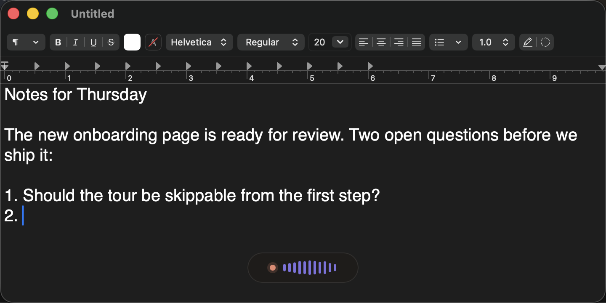
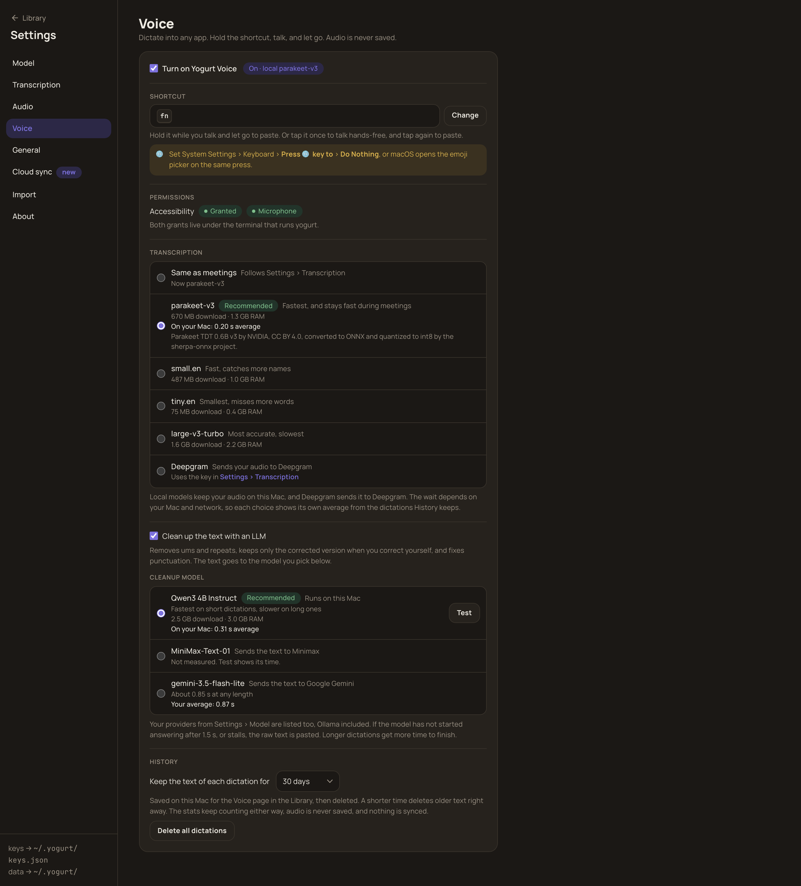
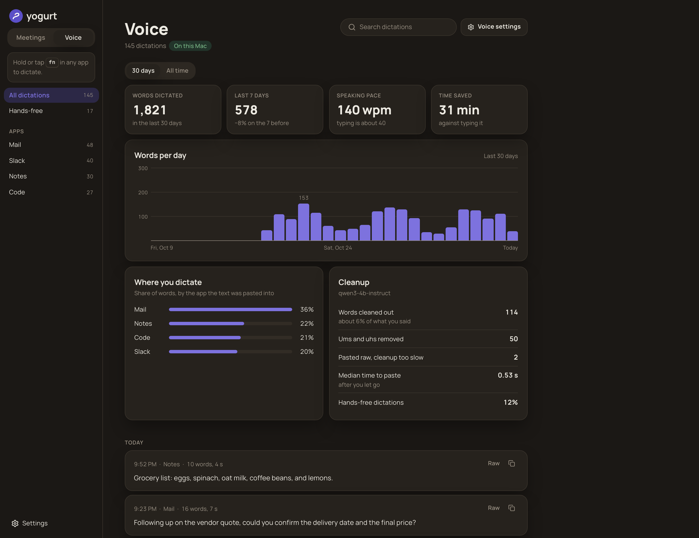

# Yogurt Voice

Yogurt Voice is dictation into any app on your Mac.
Hold the hotkey, Fn by default, talk, and let go.
Yogurt transcribes what you said and pastes it where your cursor is, then puts your clipboard back.
While you talk, a small pill at the bottom of the screen shows the mic level, and it never takes focus from the app you are typing into.

  

| You do | Voice does |
| --- | --- |
| Hold the hotkey for a quarter of a second or more, then let go | Pastes |
| Tap the hotkey | Starts a hands-free recording for long dictation, and the pill swaps its red dot for a stop mark. The next press pastes. |
| Press Esc, or another key while holding the hotkey | Cancels without pasting, so a shortcut such as Fn+arrow still works |
| Say nothing | Pastes nothing |

## Setting it up

1. Open **Settings -> Voice** and turn on Yogurt Voice.
2. Grant Accessibility once, with the Open System Settings button there.
   Yogurt is a bare binary with no `.app` bundle, so macOS charges the grant to the terminal that runs `yogurt`.
   That one grant covers both the hotkey and the paste, and Voice needs no Input Monitoring.
   Every program you run from that terminal shares the grant.
   Voice starts by itself within 2 seconds of the grant.
   The microphone grant is the one meetings already use, and macOS asks for it on the first dictation if you have never recorded a meeting.
3. If you keep Fn as the hotkey, set **System Settings -> Keyboard -> Press 🌐 key to** to **Do Nothing**.
   Otherwise macOS opens the emoji picker on the same press.
   You can instead pick a lone modifier such as Right Option, or a combo such as Option+E.
4. Download the transcription model if Settings shows a Download button, then dictate.

## Microphone

**Settings -> Voice -> Microphone** picks the mic Voice records from, separate from meetings.
Same as meetings, the default, follows the input in **Settings -> Audio**.
Each clip reads the setting when it starts, so a change applies to the next dictation.
A picked mic that is unplugged shows as unavailable, and clips record from the system default until it is back.

## Transcription

**Settings -> Voice** picks its own transcription model, separate from meetings.
The times are from release to text on an M3 Max with 64 GB.

| Model | Runs | Time | Notes |
| --- | --- | --- | --- |
| Parakeet Ultra (default) | On your Mac, CPU | About the same as v3 (see [the eval](.planning/2026-11-15-parakeet-ultra-eval.md)) | Fewer errors than v3, most of all in noise. Until it is downloaded, a Mac with v3 keeps using v3 |
| Parakeet v3 | On your Mac, CPU | 206 ms for an 11-second, 45-word clip | Stays fast while a meeting uses the GPU |
| small.en, tiny.en, large-v3-turbo | On your Mac | 409 ms for small.en on the same clip | The local whisper models from [Transcription models](../README.md#transcription-models) |
| Same as meetings | On your Mac | | Follows whichever local model **Settings -> Transcription** uses |
| Deepgram | Deepgram's API | 162 to 208 ms on clips of 2 to 31 seconds | Uses the key and model from **Settings -> Transcription**, and streams while you hold the hotkey |

If Deepgram fails or has not answered 2 seconds after you let go, Voice transcribes the clip with the default Parakeet instead, when it is downloaded.
Once you have dictated with a model, the picker also shows its average on your Mac, worked out from the dictations history keeps.

## Cleanup

Cleanup is off until you turn it on.
It removes ums and repeated words, keeps only the corrected version when you correct yourself, and fixes punctuation.
You pick the model that does it:

| Model | Runs | Notes |
| --- | --- | --- |
| Qwen3 4B Instruct (built in) | On your Mac, inside yogurt through llama.cpp | A 2.5 GB download from **Settings -> Voice**, and about 3 GB of memory while Voice and cleanup are on. On the same M3 Max it cleaned up 11, 45, and 100 words in about 0.18, 0.45, and 1.0 seconds. |
| Any HTTP provider from **Settings -> Model** | That provider, which receives the dictated text | A fast model with no reasoning step works best, because a reasoning model thinks before its first word. |

A CLI agent such as Claude Code is listed but cannot be picked, because it answers only once it has finished.
The Test button on the picked model runs a 45-word sample through it and shows its real time on your Mac.

Cleanup has a time limit that grows with the length of the dictation, and it falls back to the raw transcript:

- Voice pastes the raw transcript if the model has not started answering after 1.5 seconds, stalls for half a second, or runs past 1.5 seconds plus 25 ms per word.
- Pressing the hotkey while the pill says it is cleaning up pastes the raw text right away, and Esc cancels without pasting.
- Dictations under 4 words skip the model and get a quick rule pass instead.

  

## Try Voice

Home on the Voice page starts with a Try Voice card, to check the mic, the model, and cleanup before dictating into a real app.
Click its field and hold the shortcut as in any app, and the pill shows as usual.
When the clip ends with the field focused, the text fills the field instead of being pasted anywhere.
Under it are what the model heard, each step's model and time, and the fillers removed, and with Yogurt Pro the style and the dictionary words in the text.
With Yogurt Pro, Clean up as picks which kind of app to clean it up for, starting on Other, and switching it cleans the same words again without talking again.
The Microphone dropdown is the one in Settings -> Voice.
A try is never saved, so it adds nothing to the history, the stats, the daily totals, or the estimated cost.
The page holds the try open only while the field has focus, so a page left open never catches a real dictation.

Home in the Android app's Voice tab has the same card.
Tap its field, then the bubble, which shows over Yogurt only for this field.
After ✓ the bubble says Inserted and the card fills, with nothing saved to the phone's history.
Clean up as reruns the phone's own cleanup, and the Microphone dropdown is the one in Settings > Yogurt Voice.

## The Voice page

The Meetings | Voice switch at the top of the Library sidebar opens the Voice page.
It shows the words you have dictated, your speaking pace, and the time saved against typing, with a chart of words per day.
Two panels show which apps you dictate into and what cleanup did.
A snippet pasted for a cue counts toward the words, but not toward the speaking pace or the time saved, since a short cue pastes many words.

The Cleanup panel's Estimated cost row adds up what each cleanup cost at its model's list price, with each model's share under it when you used more than one.
Each dictation saves the tokens its provider reported, or four characters a token when the provider reports none, and is priced when it runs, so a later price change leaves past dictations as they were.
A model that runs on your Mac, the built-in Qwen3 4B or one served by Ollama or LM Studio, costs $0.
A model missing from yogurt's price table, `crates/yogurt-prompts/templates/cleanup-prices.json`, shows its tokens and how many dictations it left unpriced.
It is an estimate, and your provider's bill is the real number.
Dictations from before yogurt saved costs have none, so the estimate starts from then.
With **Share daily totals** on in Settings -> Voice, a This Mac | All devices switch adds every device that shares, your other Macs and the phone, to the tiles, the chart, and the Cleanup card, with a By device panel in place of Where you dictate.
Each device sends only its counts per day to your Yogurt Cloud, never the text or the apps, so All devices has no history.
They go up when you open the Voice page and on each push, and turning the setting off deletes this Mac's totals from the Cloud.

Below them, the history of your dictations is grouped by day, with search, the raw transcript behind each one, and a copy button.
The sidebar filters the history by app or to hands-free dictations.

  

**Settings -> Voice** sets how long the history keeps each dictation: 30 days (the default), 7 days, 24 hours, or Never save.
Never save keeps no history, so the page has nothing to search and the pickers show no averages.
The stats keep counting either way, and Delete all dictations clears both the history and the stats.

## Privacy

Audio is never saved.
Voice holds the clip in memory and drops it once the text is pasted.
The text stays in `~/.yogurt/db.sqlite` for the time you pick, and Cloud sync never pushes it.
Nothing leaves your Mac unless you pick Deepgram, which sends the audio to Deepgram, or a cloud provider for cleanup, which sends the text to that provider.
